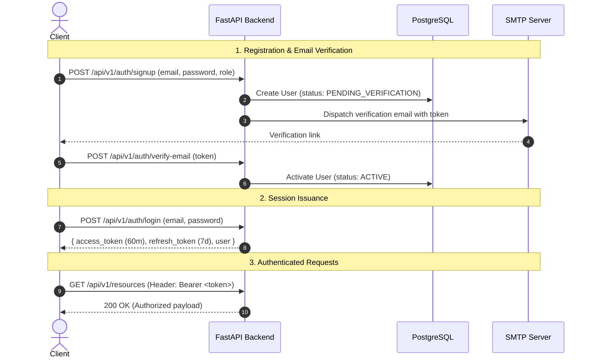

# AMU Student Resource Management System - API Documentation & Developer Portal

> **API Version:** `1.0.0`  
> **OpenAPI Specification:** `3.1.0`  
> **Base URL:** `http://localhost:8000/api/v1` (Production: `https://api.amu.edu/api/v1`)  
> **Interactive Swagger UI:** [`/api/v1/docs`](http://localhost:8000/api/v1/docs)  
> **Interactive ReDoc:** [`/api/v1/redoc`](http://localhost:8000/api/v1/redoc)  
> **OpenAPI JSON Spec:** [`openapi.json`](file:///Users/kunalarya/Downloads/CRM_integration%20testing/antigravity-project/Student%20Resource%20Mangement%20System/docs/openapi.json)

---

## 1. Executive Architecture & Design Principles

The **AMU Student Resource Management System** is an enterprise-grade backend platform providing academic content distribution, collaborative sharing, and secure storage management across Students, Teachers, and Administrators.

```
                             ┌─────────────────────────────────┐
                             │       FastAPI Gateway (v1)      │
                             │ (CORS, JWT Auth, OTel Logging)  │
                             └────────────────┬────────────────┘
                                              │
           ┌──────────────────────────────────┼──────────────────────────────────┐
           ▼                                  ▼                                  ▼
┌─────────────────────┐            ┌─────────────────────┐            ┌─────────────────────┐
│  Identity & Auth    │            │   Folder Hierarchy  │            │  Academic Resources │
│ - Email Verification│            │ - DAG Trees         │            │ - Multi-Versioning  │
│ - Password Recovery │            │ - Cycle Prevention  │            │ - Privacy-by-Default│
│ - RBAC (3 Roles)    │            │ - Path Isolation    │            │ - Granular Sharing  │
└─────────────────────┘            └─────────────────────┘            └─────────────────────┘
           │                                  │                                  │
           └──────────────────────────────────┼──────────────────────────────────┘
                                              ▼
                             ┌─────────────────────────────────┐
                             │    Storage & Quota Engine       │
                             │ - Atomic 2-Phase Reservations   │
                             │ - Supabase Storage & Webhooks   │
                             │ - MinIO / S3 Object Store       │
                             │ - Live SSE Progress Streaming   │
                             └────────────────┬────────────────┘
                                              │
                             ┌────────────────▼────────────────┐
                             │    PostgreSQL Data Layer        │
                             │ - Row-Level Lock Isolation      │
                             │ - Trigram & Vector Search       │
                             │ - Audit Logging Triggers        │
                             └─────────────────────────────────┘
```

### Architectural Guarantees
1. **Privacy by Default**: All uploaded academic resources default to `status="PRIVATE"` and `visibility="PRIVATE"`. Files are never exposed via static world-readable URLs; access requires authorization and yields time-bounded signed URLs (15-minute expiry).
2. **Atomic Quota Accounting**: Storage allocations (1 GiB for Students, 15 GiB for Teachers) are checked and reserved using PostgreSQL row-level locks (`SELECT ... FOR UPDATE`), eliminating race conditions during concurrent uploads.
3. **Per-User Storage Segregation**: Assets are partitioned into isolated paths: `users/{user_id}/{folder_name}/{unique_id}_{filename}`.
4. **Asynchronous Webhook Finalization**: Direct-to-cloud uploads to Supabase Storage trigger automated, cryptographically verified webhooks (`POST /api/v1/webhooks/supabase/storage`) to commit quotas and activate resources.

---

## 2. Authentication & Authorization (RBAC)

The API enforces RFC 7519 JSON Web Tokens (JWT) using the `HS256` signing algorithm.

### Security Scheme
- **Type**: HTTP Bearer
- **Header**: `Authorization: Bearer <access_token>`



### Role Matrix

| Capability | Student | Teacher | Administrator |
| :--- | :---: | :---: | :---: |
| Self-register & Verify Email | ✓ | ✓ | Admin created |
| Upload Resources (within quota) | ✓ (1 GiB) | ✓ (15 GiB) | ✓ (Unlimited) |
| Create Folder Hierarchies (DAG) | ✓ (Personal) | ✓ (Personal/Course)| ✓ (Global) |
| Share Resource (`VIEW`, `EDIT`) | ✓ (Owned) | ✓ (Owned/Course) | ✓ (All) |
| Revoke Share Grants | ✓ (Owned) | ✓ (Owned) | ✓ (All) |
| Download Files (Owner or Shared) | ✓ | ✓ | ✓ |
| Trigram Full-Text Search | ✓ | ✓ | ✓ |
| Adjust User Quota Limits | ✗ | ✗ | ✓ |
| View System Audit Logs & Reports | ✗ | ✗ | ✓ |

---

## 3. Complete API Endpoint Reference

### 3.1 Health & Diagnostics

#### `GET /healthz`
Diagnostic probe for container orchestrators (Kubernetes / Docker Compose) and uptime checkers.

- **Authentication**: None
- **Response `200 OK`**:
```json
{
  "status": "ok",
  "database": "connected",
  "environment": "development"
}
```

---

### 3.2 Authentication (`/api/v1/auth`)

#### `POST /api/v1/auth/signup`
Registers a new user and triggers an automated verification email.

- **Request Body**:
```json
{
  "email": "student@amu.edu",
  "password": "SecurePassword123!",
  "full_name": "Kunal Arya",
  "role_name": "Student",
  "department_code": "CS"
}
```
- **Response `201 Created`**:
```json
{
  "user_id": "3eff0bce-3e26-496b-9d16-81aeb2c9eed7",
  "email": "student@amu.edu",
  "full_name": "Kunal Arya",
  "role": { "role_id": 1, "name": "Student" },
  "department": { "department_id": 1, "code": "CS", "name": "Computer Science" },
  "status": "PENDING_VERIFICATION",
  "message": "Account created. Please check your email to verify your account."
}
```

#### `POST /api/v1/auth/verify-otp`
Verifies user email address using a 6-digit numeric OTP code received via email. Includes anti-bruteforce attempt tracking (locks after 5 failed attempts) and 15-minute expiration.

- **Request Body**:
```json
{
  "email": "student@amu.edu",
  "otp": "482910"
}
```
- **Response `200 OK`**:
```json
{
  "message": "Email verified successfully. Your account is now active and you can log in."
}
```
- **Error Responses**:
  - `400 Bad Request`: `{"detail": "Invalid verification code. 4 attempt(s) remaining."}`
  - `400 Bad Request`: `{"detail": "Maximum verification attempts exceeded. Please request a new OTP code."}`
  - `400 Bad Request`: `{"detail": "Verification code has expired or is invalid. Please request a new code."}`
  - `422 Unprocessable Entity`: Code is not 6 numeric digits.

#### `POST /api/v1/auth/resend-otp`
Resends a fresh 6-digit OTP code to unverified accounts. Enforces a 60-second cooldown rate limit to prevent email flooding.

- **Request Body**:
```json
{
  "email": "student@amu.edu"
}
```
- **Response `200 OK`**:
```json
{
  "message": "If your account is pending verification, a new OTP code has been sent to your email."
}
```
- **Error Responses**:
  - `429 Too Many Requests`: `{"detail": "Please wait 45 seconds before requesting a new OTP code."}`

#### `POST /api/v1/auth/verify-email`
Verifies an account using the token dispatched in the verification email.

- **Request Body**: `{ "token": "eyJhbGciOiJIUzI1NiIsInR5cCI6IkpXVCJ9..." }`
- **Response `200 OK`**: `{ "message": "Email verified successfully. Your account is now active and you can log in." }`

#### `GET /api/v1/auth/verify-email?token={token}`
Verifies account via direct browser/email link click.

- **Query Param**: `token`
- **Response `200 OK`**: `{ "message": "Email verified successfully. Your account is now active and you can log in." }`

#### `POST /api/v1/auth/resend-verification`
Resends token-based verification link to pending unverified accounts.

- **Request Body**: `{ "email": "student@amu.edu" }`
- **Response `200 OK`**: `{ "message": "If your account is pending verification, a new confirmation link has been sent to your email." }`

#### `POST /api/v1/auth/login`
Authenticates user credentials and issues access/refresh tokens.

- **Request Body**: `{ "email": "student@amu.edu", "password": "SecurePassword123!" }`
- **Response `200 OK`**:
```json
{
  "access_token": "eyJhbGciOiJIUzI1NiIsInR5cCI6IkpXVCJ9...",
  "refresh_token": "eyJhbGciOiJIUzI1NiIsInR5cCI6IkpXVCJ9...",
  "token_type": "bearer",
  "expires_in": 3600,
  "user": {
    "user_id": "3eff0bce-3e26-496b-9d16-81aeb2c9eed7",
    "email": "student@amu.edu",
    "full_name": "Kunal Arya",
    "role": "Student"
  }
}
```

#### `POST /api/v1/auth/refresh`
Rotates the refresh token and issues a new access token.

- **Request Body**: `{ "refresh_token": "eyJhbGciOiJIUzI1NiIsInR5cCI6IkpXVCJ9..." }`
- **Response `200 OK`**: Returns refreshed `access_token` and `refresh_token`.

#### `POST /api/v1/auth/forgot-password`
Generates a 30-minute password reset token dispatched to the registered email address.

- **Request Body**: `{ "email": "student@amu.edu" }`
- **Response `200 OK`**: `{ "message": "If this email is registered, password reset instructions have been sent." }`

#### `POST /api/v1/auth/reset-password`
Consumes the password reset token and sets a new password.

- **Request Body**: `{ "token": "rtok_x9y8z7...", "new_password": "BrandNewPassword2026!" }`
- **Response `200 OK`**: `{ "message": "Password reset successfully. You can now log in with your new password." }`

#### `GET /api/v1/auth/me`
Retrieves currently authenticated user profile and permissions.

- **Headers**: `Authorization: Bearer <access_token>`
- **Response `200 OK`**: Returns authenticated `UserRead` model.

---

### 3.3 Folders & Hierarchy DAG (`/api/v1/folders`)

Folders implement a Directed Acyclic Graph (DAG) with **strict cycle detection** preventing infinite recursion (e.g., folder A cannot be moved inside its own child).

#### `GET /api/v1/folders`
Lists root folders belonging to the authenticated user.

#### `POST /api/v1/folders`
Creates a new directory in the user's hierarchy.

- **Request Body**:
```json
{
  "name": "Machine_Learning",
  "parent_folder_id": null
}
```
- **Response `201 Created`**:
```json
{
  "folder_id": "7a8b9c0d-1e2f-3a4b-5c6d-7e8f9a0b1c2d",
  "owner_id": "3eff0bce-3e26-496b-9d16-81aeb2c9eed7",
  "parent_folder_id": null,
  "name": "Machine_Learning",
  "created_at": "2026-10-24T02:00:00Z"
}
```

#### `GET /api/v1/folders/{folder_id}/contents`
Retrieves direct subfolders and resources stored in this folder.

---

### 3.4 Resources & Versions (`/api/v1/resources`)

#### `GET /api/v1/resources`
Lists resources accessible to the user (owned or shared), with support for pagination (`skip`, `limit`) and status filters.

#### `POST /api/v1/resources/upload` *(Direct Supabase Upload)*
Direct multipart upload storing binary payload into user-isolated Supabase storage path: `users/{user_id}/{folder_name}/{unique_id}_{filename}`.

- **Content-Type**: `multipart/form-data`
- **Form Fields**:
  - `file`: Binary file payload
  - `title`: `Quantum Computing Notes`
  - `description`: *(Optional)* Notes for Lecture 5
  - `folder_id`: *(Optional)* UUID of target folder
- **Response `201 Created`**:
```json
{
  "resource_id": "a1b2c3d4-e5f6-7a8b-9c0d-1e2f3a4b5c6d",
  "title": "Quantum Computing Notes",
  "status": "PRIVATE",
  "visibility": "PRIVATE",
  "owner_id": "3eff0bce-3e26-496b-9d16-81aeb2c9eed7",
  "created_at": "2026-10-24T02:30:00Z"
}
```

#### `GET /api/v1/resources/{resource_id}/download`
Generates a **time-limited signed download URL (15-minute expiry)**. Unshared private resources accessed by non-owners return `403 Forbidden`.

- **Response `200 OK`**:
```json
{
  "download_url": "https://ijlfghksvuyoynshxoif.storage.supabase.co/storage/v1/object/sign/files/users/3eff0bce-3e26-496b-9d16-81aeb2c9eed7/assignments/notes.pdf?token=eyJhbGciOi...",
  "filename": "notes.pdf",
  "expires_in_seconds": 900
}
```

#### `POST /api/v1/resources/{resource_id}/versions`
Uploads a new revision of an existing resource, incrementing `version_number`.

---

### 3.5 Sharing & Access Governance (`/api/v1/resources/{resource_id}/share`)

#### `POST /api/v1/resources/{resource_id}/share`
Grants explicit access (`VIEW` or `EDIT`) to a specific user.

- **Request Body**:
```json
{
  "email": "teacher@amu.edu",
  "permission": "VIEW"
}
```
- **Response `201 Created`**:
```json
{
  "access_id": "b2c3d4e5-f6a7-8b9c-0d1e-2f3a4b5c6d7e",
  "resource_id": "a1b2c3d4-e5f6-7a8b-9c0d-1e2f3a4b5c6d",
  "user_id": "4f5a6b7c-8d9e-0f1a-2b3c-4d5e6f7a8b9c",
  "permission": "VIEW",
  "granted_by": "3eff0bce-3e26-496b-9d16-81aeb2c9eed7",
  "created_at": "2026-10-24T02:35:00Z"
}
```

#### `GET /api/v1/resources/{resource_id}/share`
Lists all active grants on a resource (Accessible only by Resource Owner or Administrator).

#### `DELETE /api/v1/resources/{resource_id}/share/{access_id}`
Revokes an access grant immediately. Downstream download attempts by the user instantly return `403 Forbidden`.

---

### 3.6 Two-Phase Upload Protocol & Progress (`/api/v1/uploads`)

This protocol guarantees zero-quota oversubscription and real-time frontend upload progress monitoring.

```
Frontend                    FastAPI Backend               PostgreSQL Quota
   │                              │                              │
   │  1. POST /uploads/initiate   │                              │
   │─────────────────────────────▶│  Lock quota row for update   │
   │                              │─────────────────────────────▶│
   │                              │  Increment reserved_bytes    │
   │  2. reservation_id & PUT url │◀─────────────────────────────│
   │◀─────────────────────────────│                              │
   │                              │                              │
   │  3. Binary Upload to S3/Cloud│                              │
   │═════════════════════════════▶│ (Direct to MinIO/Supabase)   │
   │                              │                              │
   │  4. PATCH /uploads/{id}/prog │                              │
   │─────────────────────────────▶│ (Updates progress: 0% -> 99%)│
   │                              │                              │
   │  5. GET /uploads/{id}/events │ (Server-Sent Events Stream)  │
   │◀┄┄┄┄┄┄┄┄┄┄┄┄┄┄┄┄┄┄┄┄┄┄┄┄┄┄┄┄│                              │
   │                              │                              │
   │  6. POST /uploads/complete   │  Deduct reserved_bytes       │
   │     (or Supabase Webhook)    │  Increment used_bytes        │
   │─────────────────────────────▶│─────────────────────────────▶│
   │  7. Status = COMPLETED (100%)│                              │
   │◀─────────────────────────────│                              │
```

#### `POST /api/v1/uploads/initiate`
**Phase 1**: Checks quota under row lock and reserves bytes. Returns a short-lived presigned upload URL.

- **Request Body**:
```json
{
  "filename": "thesis_draft.pdf",
  "content_type": "application/pdf",
  "size_bytes": 10485760
}
```
- **Response `201 Created`**:
```json
{
  "reservation_id": "e1667292-a1ef-43fb-a759-76446061c29d",
  "upload_url": "http://localhost:9000/academic-resources/uploads/...",
  "object_key": "uploads/3eff0bce-3e26-496b-9d16-81aeb2c9eed7/e1667292.../thesis_draft.pdf",
  "expires_at": "2026-10-24T03:00:00Z",
  "reserved_bytes": 10485760
}
```

#### `GET /api/v1/uploads/{reservation_id}/status`
Polls live upload status, completion percentage, and linked resource ID.

- **Response `200 OK`**:
```json
{
  "reservation_id": "e1667292-a1ef-43fb-a759-76446061c29d",
  "user_id": "3eff0bce-3e26-496b-9d16-81aeb2c9eed7",
  "status": "UPLOADING",
  "progress_percent": 65,
  "bytes_uploaded": 6815744,
  "total_bytes": 10485760,
  "object_key": "uploads/3eff0bce-3e26-496b-9d16-81aeb2c9eed7/...",
  "filename": "thesis_draft.pdf",
  "resource_id": null,
  "created_at": "2026-10-24T02:30:00Z",
  "updated_at": "2026-10-24T02:30:15Z"
}
```

#### `PATCH /api/v1/uploads/{reservation_id}/progress`
Updates in-flight transmission progress as chunks are sent from the browser.

- **Request Body**: `{ "progress_percent": 65, "bytes_uploaded": 6815744 }`
- **Response `200 OK`**: Updated `UploadStatusResponse`.

#### `GET /api/v1/uploads/{reservation_id}/events`
**Server-Sent Events (SSE)** real-time stream (`text/event-stream`). Emits JSON event payloads on status change or completion without polling. Supports query parameter `max_events` for pulse checks.

- **Stream output**:
```text
data: {"reservation_id":"e1667292...","status":"UPLOADING","progress_percent":65,"bytes_uploaded":6815744,"total_bytes":10485760,"resource_id":null}

data: {"reservation_id":"e1667292...","status":"COMPLETED","progress_percent":100,"bytes_uploaded":10485760,"total_bytes":10485760,"resource_id":"a1b2c3d4..."}
```

#### `POST /api/v1/uploads/complete`
**Phase 2**: Verifies object in object storage, checks actual byte sizes, commits `used_bytes`, releases `reserved_bytes`, and marks status `COMPLETED`.

#### `POST /api/v1/uploads/{reservation_id}/cancel`
Releases reserved quota bytes immediately if the upload is aborted by the user.

---

### 3.7 Supabase Storage Webhook (`/api/v1/webhooks/supabase/storage`)

Receives automated notifications when objects land in Supabase Storage (`storage.objects`).

- **Method**: `POST`
- **Headers**:
  - `Content-Type`: `application/json`
  - `X-Webhook-Secret`: `<SUPABASE_WEBHOOK_SECRET>` (or `Authorization: Bearer <secret>`)
- **Payload**:
```json
{
  "type": "INSERT",
  "table": "objects",
  "schema": "storage",
  "record": {
    "name": "users/3eff0bce-3e26-496b-9d16-81aeb2c9eed7/assignments/research_paper.pdf",
    "bucket_id": "files",
    "metadata": {
      "size": 1048576,
      "mimetype": "application/pdf",
      "eTag": "\"etag-12345\""
    }
  }
}
```
- **Response `200 OK`**:
```json
{
  "status": "success",
  "message": "Storage upload confirmed, quota committed, and resource activated.",
  "event_type": "INSERT",
  "object_key": "users/3eff0bce-3e26-496b-9d16-81aeb2c9eed7/assignments/research_paper.pdf",
  "resource_id": "a1b2c3d4-e5f6-7a8b-9c0d-1e2f3a4b5c6d"
}
```

---

### 3.8 Full-Text & Trigram Search (`/api/v1/search`)

#### `GET /api/v1/search`
Searches academic resources using PostgreSQL full-text search (`tsvector`) and trigram fuzzy matching (`pg_trgm`).

- **Query Parameters**:
  - `q`: Search keyword (e.g. `Quantum Computing`)
  - `subject_id`: Optional subject filter
  - `academic_year_id`: Optional year filter
  - `department_id`: Optional department filter
  - `skip`, `limit`: Pagination parameters

---

### 3.9 Administration & Governance (`/api/v1/admin`)

*Restricted to users with role `Administrator`.*

#### `GET /api/v1/admin/audit-logs`
Queries tamper-evident system audit trail (who performed what action, on which entity, with IP and timestamp).

#### `GET /api/v1/admin/reports/storage`
Generates comprehensive storage usage analytics across departments, roles, and utilization percentiles.

#### `PUT /api/v1/admin/users/{user_id}/quota`
Overrides storage quota allowance for a specific student or teacher.

- **Request Body**: `{ "quota_bytes": 5368709120 }` (Set to 5 GiB)

---

## 4. Multi-Language SDK & Client Integration Examples

### Example 1: Authenticate & Download Resource

````carousel
```bash
# cURL
curl -X GET "http://localhost:8000/api/v1/resources/a1b2c3d4-e5f6-7a8b-9c0d-1e2f3a4b5c6d/download" \
     -H "Authorization: Bearer $ACCESS_TOKEN" \
     -H "Accept: application/json"
```
<!-- slide -->
```typescript
// TypeScript (Fetch)
interface DownloadResponse {
  download_url: string;
  filename: string;
  expires_in_seconds: number;
}

async function getResourceDownloadUrl(resourceId: string, token: string): Promise<string> {
  const response = await fetch(`http://localhost:8000/api/v1/resources/${resourceId}/download`, {
    headers: { 'Authorization': `Bearer ${token}` }
  });
  if (!response.ok) throw new Error(`Download failed: ${response.statusText}`);
  const data: DownloadResponse = await response.json();
  return data.download_url;
}
```
<!-- slide -->
```python
# Python (HTTPX)
import httpx

async def fetch_download_url(resource_id: str, token: str) -> str:
    headers = {"Authorization": f"Bearer {token}"}
    async with httpx.AsyncClient() as client:
        res = await client.get(
            f"http://localhost:8000/api/v1/resources/{resource_id}/download",
            headers=headers
        )
        res.raise_for_status()
        return res.json()["download_url"]
```
````

---

### Example 2: In-Flight Progress with Server-Sent Events (SSE)

````carousel
```typescript
// TypeScript (Browser EventSource)
function trackUploadProgress(reservationId: string) {
  const eventSource = new EventSource(`/api/v1/uploads/${reservationId}/events`);

  eventSource.onmessage = (event) => {
    const status = JSON.parse(event.data);
    console.log(`Upload Progress: ${status.progress_percent}% - Status: ${status.status}`);

    // Update UI progress bar
    document.getElementById('progress-bar').style.width = `${status.progress_percent}%`;

    if (status.status === 'COMPLETED') {
      eventSource.close();
      console.log('Upload verified! Resource ID:', status.resource_id);
    } else if (status.status === 'FAILED') {
      eventSource.close();
      console.error('Upload failed:', status.error_message);
    }
  };
}
```
<!-- slide -->
```python
# Python (HTTPX SSE Client)
import httpx
import json

async def monitor_upload_stream(reservation_id: str, token: str):
    headers = {"Authorization": f"Bearer {token}"}
    async with httpx.AsyncClient() as client:
        async with client.stream(
            "GET", 
            f"http://localhost:8000/api/v1/uploads/{reservation_id}/events",
            headers=headers
        ) as stream:
            async for line in stream.aiter_lines():
                if line.startswith("data:"):
                    data = json.loads(line[5:].strip())
                    print(f"Status: {data['status']} ({data['progress_percent']}%)")
                    if data["status"] in ("COMPLETED", "FAILED"):
                        break
```
````

---

## 5. Standardized Error Handling (RFC 7807)

All non-2xx responses conform to a predictable structure:

```json
{
  "detail": "Descriptive, human-readable error message indicating root cause."
}
```

### HTTP Status Code Catalog

| Code | Name | Scenario |
| :---: | :--- | :--- |
| `200` | OK | Query, retrieval, or update successful. |
| `201` | Created | Entity or reservation successfully created. |
| `400` | Bad Request | Malformed payload, invalid password format, or missing parameter. |
| `401` | Unauthorized | Missing, invalid, or expired JWT token, or incorrect webhook secret. |
| `403` | Forbidden | Insufficient RBAC permission, accessing another user's private unshared resource. |
| `404` | Not Found | Entity (resource, folder, user, version) does not exist. |
| `409` | Conflict | Duplicate unique attribute (email, subject code, or cyclic folder move). |
| `413` | Content Too Large | Storage quota exceeded (requested bytes > available quota). |
| `422` | Unprocessable Entity | Pydantic validation failure (type mismatch or schema constraint breach). |
| `500` | Internal Server Error | Unhandled server exception (logged with OpenTelemetry trace ID). |

---

## 6. Developer Onboarding & Local Setup

```bash
# 1. Clone repository & change directory
cd "Student Resource Mangement System/backend"

# 2. Install dependencies via uv
uv sync

# 3. Spin up local PostgreSQL container
docker compose up -d

# 4. Run database migrations to head
uv run alembic upgrade head

# 5. Seed initial roles, departments, academic years, and demo accounts
uv run python -m app.db.seed

# 6. Run the FastAPI development server
uv run uvicorn app.main:app --reload --port 8000
```
Open **[http://localhost:8000/api/v1/docs](http://localhost:8000/api/v1/docs)** in your browser for interactive API exploration.
