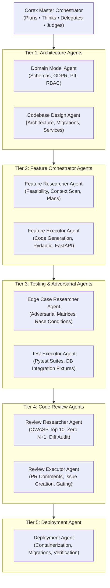

# Agent Orchestration Sequence & Development Workflow Guide
**System:** AMU Student Resource Management System  
**Framework:** Corex Engine Multi-Agent Matrix  
**Specification Reference:** `.agents/AGENTS.md` and `.agents/rules/`  
**Document Path:** `implementations/agent_orchestration_sequence.md`

---

## 1. Executive Agent Architecture Overview

The development of the Student Resource Management System is governed by the **Corex Orchestrator** using a **5-Tier Specialized Agent Matrix**. High-level cognitive responsibilities (**planning, architecture, adversarial thinking, review**) are strictly decoupled from low-level execution (**coding, script execution, test implementation**).



---

## 2. Standard Feature Execution Pipeline (Agent Sequence)

Every phase, feature, or sub-module in the backend roadmap follows this strict **7-step sequential handoff**:

```
[Feature Ticket / Phase Milestone]
                │
                ▼
Step 1: Corex Master Orchestrator
        • Formulates DAG milestone and task handoff boundary
                │
                ▼
Step 2: Architecture Tier (Domain Model & Codebase Design)
        • Step 2a: Domain Model Agent — Schema integrity, GDPR, PII masking, RBAC
        • Step 2b: Codebase Design Agent — Async patterns, transactions, migrations
                │
                ▼
Step 3: Feature Researcher Agent
        • Identifies existing utilities, schema contracts, dependencies, and file diff plan
                │
                ▼
Step 4: Feature Executor Agent
        • Writes strongly-typed Python 3.12+ FastAPI code, schemas, and services
                │
                ▼
Step 5: Testing Tier (Edge Case Researcher & Test Executor)
        • Step 5a: Edge Case Researcher Agent — Builds adversarial failure matrix
        • Step 5b: Test Executor Agent — Writes and executes real-DB Pytest suites
                │
                ▼
Step 6: Code Review Tier (Review Researcher & Review Executor)
        • Step 6a: Review Researcher Agent — Scans security, performance, N+1 queries
        • Step 6b: Review Executor Agent — Verifies acceptance criteria before merge
                │
                ▼
Step 7: Deployment Agent
        • Runs database migration dry-run, container verification, and health check validation
```

---

## 3. Detailed Agent Roster & Model Selection Strategy

| Step | Agent Name | Tier | Recommended Model | Primary Skills & Rules Loaded | Core Responsibilities |
| :--- | :--- | :--- | :--- | :--- | :--- |
| **0** | **Corex Orchestrator** | Master | **Claude 3.7 Sonnet (Thinking)** / **Claude Opus** | `context-manager`, `backend-architect` | Decomposes tickets into executable DAGs; context budgeting; handoff artifacts; halts regressions. |
| **1** | **Domain Model Agent** | Tier 1: Architecture | **Claude 3.7 Sonnet (Thinking)** / **Claude Opus** | `sql-pro`, `gdpr-data-handling`, `crm-gdpr-auditor`, Rule 02 | Designs relational schemas, foreign key cascade policies, PII data segregation, consent audit trails, and RBAC tables. |
| **2** | **Codebase Design Agent**| Tier 1: Architecture | **Claude 3.5 Sonnet** / **GPT-4o** | `fastapi-pro`, `architecture-patterns`, `database-migration`, Rule 01 | Designs service boundaries, async SQLAlchemy sessions, atomic transaction policies (`select_for_update`), and Alembic migrations. |
| **3** | **Feature Researcher Agent** | Tier 2: Feature | **Gemini 2.0 Pro/Flash** / **Claude 3.5 Sonnet** | `api-design-principles`, `fastapi-templates`, Rule 01 | Scans codebase context; discovers reusable components; builds concrete implementation plan and file list. |
| **4** | **Feature Executor Agent** | Tier 2: Feature | **Claude 3.5 Sonnet** / **GPT-4o** | `python-pro`, `fastapi-pro`, Rule 01, Rule 02 | Writes strongly-typed Python 3.12 code: Pydantic v2 schemas, FastAPI routes, and domain services. |
| **5** | **Edge Case Researcher Agent** | Tier 3: Testing | **Claude 3.7 Sonnet (Thinking)** / **o3 / o1** | `crm-edge-case-tester`, `error-detective`, Rule 03 | Discovers real-world failure modes: concurrent quota races, S3 timeout dropouts, folder cycles, and malicious payloads. |
| **6** | **Test Executor Agent** | Tier 3: Testing | **Claude 3.5 Sonnet** / **GPT-4o** | `python-testing-patterns`, Rule 03 | Implements pytest-asyncio integration tests using real PostgreSQL test containers; enforces zero database mocking in integration suites. |
| **7** | **Review Researcher Agent** | Tier 4: Review | **Claude 3.7 Sonnet (Thinking)** / **Claude Opus** | `code-reviewer`, `backend-security-coder`, `architect-review`, Rule 01 | Deep static diff analysis; verifies zero N+1 queries, OWASP Top 10 vulnerabilities, and API contract fidelity. |
| **8** | **Review Executor Agent** | Tier 4: Review | **GPT-4o** / **Claude 3.5 Sonnet** | `git-pr-workflows-pr-enhance`, `code-review-excellence` | Formulates structured review verdicts, PR status labels (`approved`, `needs-work`), and actionable remediation items. |
| **9** | **Deployment Agent** | Tier 5: Deployment | **Claude 3.5 Sonnet** / **GPT-4o** | `cicd-automation-workflow-automate` | Executes migration roll-forward, Docker multi-stage builds, container health inspections, and smoke tests. |

---

## 4. Phase-by-Phase Agent Routing Across Backend Development

Below is the exact agent routing across the 10 backend phases defined in [`implementations/backend_implementation_plan.md`](file:///Users/kunalarya/Downloads/CRM_integration%20testing/antigravity-project/Student%20Resource%20Mangement%20System/implementations/backend_implementation_plan.md):

### Phase 1: Environment, Dependencies & Local Infrastructure
* **Lead Agent:** **Codebase Design Agent**
* **Supporting Agent:** **Deployment Agent**
* **Task Sequence:**
  1. *Codebase Design Agent*: Configures `backend/pyproject.toml`, `app/core/config.py`, async DB session factory, and directory structure.
  2. *Deployment Agent*: Creates `docker-compose.yml` (PostgreSQL 16 + MinIO + MinIO bucket auto-provisioning).
  3. *Test Executor Agent*: Runs smoke test verifying container reachability and `/healthz`.

### Phase 2: Relational Domain Models, Alembic Migrations & Seeding
* **Lead Agent:** **Domain Model Agent**
* **Supporting Agents:** **Codebase Design Agent** $\rightarrow$ **Feature Executor Agent** $\rightarrow$ **Test Executor Agent**
* **Task Sequence:**
  1. *Domain Model Agent*: Validates schema definitions for 15 entities (`ROLES`, `USERS`, `FOLDERS`, `RESOURCES`, `STORAGE_QUOTAS`, `UPLOAD_RESERVATIONS`, `AUDIT_EVENTS`) against Rule 02 (GDPR, PII isolation, deletion cascades).
  2. *Codebase Design Agent*: Formulates Alembic async migration setup and migration scripts.
  3. *Feature Executor Agent*: Implements SQLAlchemy models in `app/models/` and seed script in `app/db/seed.py`.
  4. *Test Executor Agent*: Executes `alembic upgrade head` and verifies idempotent seeding.

### Phase 3: Authentication, Authorization & User Management Module
* **Lead Agent:** **Feature Researcher Agent** $\rightarrow$ **Feature Executor Agent**
* **Adversarial & Review Agents:** **Edge Case Researcher Agent** $\rightarrow$ **Test Executor Agent** $\rightarrow$ **Review Researcher Agent**
* **Task Sequence:**
  1. *Feature Researcher Agent*: Inspects JWT/Bcrypt token lifetime and cookie/header transport patterns.
  2. *Feature Executor Agent*: Implements `app/core/security.py`, `app/core/dependencies.py` (`require_role`), and `/api/v1/auth/*` endpoints.
  3. *Edge Case Researcher Agent*: Formulates attack vectors: expired tokens, forged signatures, role escalation attacks.
  4. *Test Executor Agent*: Implements `tests/test_auth.py` verifying 401 and 403 status codes.
  5. *Review Researcher Agent*: Audits for timing attacks, secret leaks, and password hash cost parameters.

### Phase 4: Folder Management & Hierarchical Navigation
* **Lead Agent:** **Codebase Design Agent** $\rightarrow$ **Feature Executor Agent**
* **Adversarial & Testing Agents:** **Edge Case Researcher Agent** $\rightarrow$ **Test Executor Agent**
* **Task Sequence:**
  1. *Codebase Design Agent*: Designs recursive CTE for ancestor traversal and deletion constraint logic (`SD-09`).
  2. *Feature Executor Agent*: Implements `app/services/folder_service.py` and `app/api/v1/folders.py`.
  3. *Edge Case Researcher Agent*: Formulates DAG cycle attack cases (Folder A $\rightarrow$ Folder B $\rightarrow$ Folder A).
  4. *Test Executor Agent*: Implements `tests/test_folder_dag.py` verifying cycle rejection and non-empty deletion refusal.

### Phase 5: Storage Quota Management & S3/MinIO Upload Pipeline
* **Lead Agent:** **Codebase Design Agent** $\rightarrow$ **Feature Executor Agent**
* **Adversarial & Testing Agents:** **Edge Case Researcher Agent (Critical)** $\rightarrow$ **Test Executor Agent**
* **Task Sequence:**
  1. *Codebase Design Agent*: Designs two-phase atomic quota reservation with `SELECT ... FOR UPDATE` on `StorageQuota`.
  2. *Feature Executor Agent*: Implements `app/services/storage_service.py` (Aioboto3), `quota_service.py`, and `/api/v1/uploads/*`.
  3. *Edge Case Researcher Agent*: Designs concurrency race condition test: 5 simultaneous uploads competing for remaining quota.
  4. *Test Executor Agent*: Implements `tests/test_quota_concurrency.py` with multi-threaded/async simultaneous requests.

### Phase 6: Resource Lifecycle, External Links & Multi-Versioning
* **Lead Agent:** **Domain Model Agent** $\rightarrow$ **Feature Executor Agent**
* **Testing & Review Agents:** **Test Executor Agent** $\rightarrow$ **Review Researcher Agent**
* **Task Sequence:**
  1. *Domain Model Agent*: Validates state transitions (`PRIVATE` for students, `APPROVED` for teachers) and SSRF protections for external URLs.
  2. *Feature Executor Agent*: Implements `app/services/resource_service.py` and `app/api/v1/resources.py`.
  3. *Test Executor Agent*: Verifies version number incrementation and presigned download URL generation.
  4. *Review Researcher Agent*: Audits object download authorization checks.

### Phase 7: Granular Sharing & Access Control
* **Lead Agent:** **Feature Executor Agent** $\rightarrow$ **Edge Case Researcher Agent** $\rightarrow$ **Test Executor Agent**
* **Task Sequence:**
  1. *Feature Executor Agent*: Implements `app/services/sharing_service.py` and `app/api/v1/sharing.py`.
  2. *Edge Case Researcher Agent*: Formulates permission bypass tests: non-owner attempting to share; revoked user downloading cached URLs.
  3. *Test Executor Agent*: Implements `tests/test_sharing.py`.

### Phase 8: Search, Discovery & Metadata Filtering
* **Lead Agent:** **Codebase Design Agent** $\rightarrow$ **Feature Executor Agent**
* **Task Sequence:**
  1. *Codebase Design Agent*: Designs PostgreSQL GIN index on `tsvector` and strict security filter predicate.
  2. *Feature Executor Agent*: Implements `app/services/search_service.py` and `app/api/v1/search.py`.
  3. *Test Executor Agent*: Verifies search never leaks private files of other students.

### Phase 9: Administration, Audit Logging & Storage Analytics
* **Lead Agent:** **Domain Model Agent** $\rightarrow$ **Feature Executor Agent** $\rightarrow$ **Review Researcher Agent**
* **Task Sequence:**
  1. *Domain Model Agent*: Ensures audit events contain full actor provenance without logging plaintext PII.
  2. *Feature Executor Agent*: Implements `app/services/audit_service.py` and `app/api/v1/admin.py`.
  3. *Review Researcher Agent*: Audits administrative access boundaries and immutable log integrity.

### Phase 10: Edge-Case Hardening, Automated Testing & Containerization
* **Lead Agent:** **Edge Case Researcher Agent** $\rightarrow$ **Test Executor Agent** $\rightarrow$ **Deployment Agent**
* **Task Sequence:**
  1. *Edge Case Researcher Agent*: Formulates end-to-end chaos matrix.
  2. *Test Executor Agent*: Runs comprehensive test suite; verifies coverage > 85%.
  3. *Deployment Agent*: Builds multi-stage production `Dockerfile`, runs security scan, and verifies zero-downtime startup.

---

## 5. Summary Handoff Artifact Checklist

To maintain context efficiency between agents, every transition must use a **Task Handoff Artifact** containing:
1. **Goal & Acceptance Criteria:** Exactly what this agent must produce.
2. **Context Bundle:** Only the relevant schemas, models, and service interfaces.
3. **Allowed Toolset & Rules:** Relevant rules (`Rule 01`, `Rule 02`, `Rule 03`) and skills.
4. **Verification Requirement:** The exact command or assertion to validate before handing off to the next agent.
