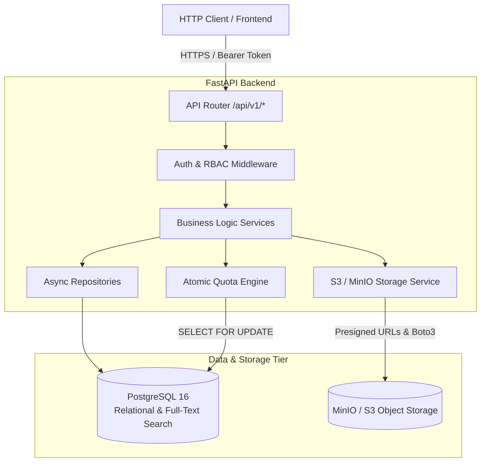

# Student Resource Management System — Phased Backend Implementation Plan
**Document Version:** 1.0  
**Target Architecture:** FastAPI (Python 3.12+) • SQLAlchemy 2.0 Async • PostgreSQL 16 • MinIO / S3  
**Document Path:** `implementations/phased_implementation_plan.md`  
*(Refer also to `implementations/backend_implementation_plan.md` for the dedicated reference document)*

---

## 1. System Overview & Backend Architecture

The backend of the **Student Resource Management System** is architected as a high-performance **modular monolith** powered by FastAPI, asynchronous SQLAlchemy 2.0, PostgreSQL 16, and an S3-compatible object storage layer (MinIO for local development; AWS S3/Cloudflare R2 for production).

### 1.1 Architectural Pattern
The backend follows clean layered architecture with clear separation of concerns:
- **Presentation Layer (`app/api/v1/`):** REST API endpoints, parameter validation (Pydantic v2), dependency injection (`Depends`), and HTTP status codes.
- **Service Layer (`app/services/`):** Encapsulates core business rules, transactional boundaries, quota calculations, folder cycle prevention, and resource lifecycle logic.
- **Repository Layer (`app/repositories/`):** Encapsulates direct database queries and mutations using async SQLAlchemy 2.0 session.
- **Data & Storage Layer (`app/models/`, S3):** PostgreSQL relational tables and S3-compatible private object storage.



---

## 2. Directory Structure Blueprint

```
backend/
├── app/
│   ├── main.py                     # App factory, CORS, exception handlers, lifespans
│   ├── core/
│   │   ├── config.py               # Pydantic Settings (ENV variables, secrets)
│   │   ├── database.py             # Async engine, sessionmaker, Base model
│   │   ├── security.py             # Password hashing (bcrypt), JWT creation & verification
│   │   ├── exceptions.py           # Custom domain exceptions & HTTP mappings
│   │   └── dependencies.py         # DB session, auth user, role guards
│   ├── models/
│   │   ├── base.py                 # TimestampMixin, UUIDMixin
│   │   ├── user.py                 # Role, Department, User, StudentSubject, TeacherSubject
│   │   ├── folder.py               # Folder (self-referential)
│   │   ├── resource.py             # Resource, ResourceVersion, Tag, ResourceTag, ResourceAccess
│   │   ├── storage.py              # StorageObject, StorageQuota, UploadReservation
│   │   └── audit.py                # AuditEvent
│   ├── schemas/
│   │   ├── common.py               # Pagination, standard response wrappers
│   │   ├── auth.py                 # Token, TokenPayload, LoginRequest
│   │   ├── user.py                 # UserCreate, UserRead, UserUpdate
│   │   ├── folder.py               # FolderCreate, FolderUpdate, FolderRead, FolderTree
│   │   ├── resource.py             # ResourceCreate, ResourceRead, ResourceVersionRead
│   │   ├── upload.py               # UploadInitiate, UploadComplete, ReservationRead
│   │   ├── sharing.py              # ShareGrantCreate, ShareGrantRead
│   │   ├── storage.py              # QuotaRead, QuotaUpdate
│   │   └── admin.py                # StorageReport, AuditLogRead
│   ├── repositories/
│   │   ├── base_repository.py      # Generic async CRUD operations
│   │   ├── user_repository.py
│   │   ├── folder_repository.py
│   │   ├── resource_repository.py
│   │   └── storage_repository.py
│   ├── services/
│   │   ├── auth_service.py         # Login, token refreshing, password resets
│   │   ├── user_service.py         # User onboarding, quota initialization
│   │   ├── folder_service.py       # DAG cycle detection, non-empty deletion checks
│   │   ├── quota_service.py        # Atomic 2-phase reservation engine
│   │   ├── storage_service.py      # S3/MinIO presigned URLs, object verification
│   │   ├── resource_service.py     # Student private vs. teacher auto-approval rules
│   │   ├── sharing_service.py      # Access grant resolution
│   │   ├── search_service.py       # PostgreSQL full-text search with auth filter
│   │   └── audit_service.py        # Immutable audit logging
│   ├── api/
│   │   └── v1/
│   │       ├── router.py           # Unified v1 router aggregator
│   │       ├── auth.py             # POST /login, POST /logout, GET /me
│   │       ├── users.py            # GET /users/me, PATCH /users/me
│   │       ├── folders.py          # CRUD + /folders/{id}/contents
│   │       ├── resources.py        # CRUD + /resources/{id}/versions
│   │       ├── uploads.py          # /uploads/initiate, /uploads/{id}/complete
│   │       ├── sharing.py          # /resources/{id}/share
│   │       ├── search.py           # GET /search?q=...
│   │       ├── storage.py          # GET /storage/quota
│   │       └── admin.py            # /admin/users, /admin/reports/storage, /admin/audit-logs
│   └── tests/
│       ├── conftest.py             # Async client fixture, test DB engine, MinIO mock
│       ├── unit/                   # Unit tests (password hashing, cycle detection)
│       └── integration/            # API integration tests (quota race, RBAC, workflows)
├── alembic/
│   ├── env.py                      # Async migration runner
│   ├── script.py.mako
│   └── versions/                   # Migration version files
├── alembic.ini
├── pyproject.toml                  # Python 3.12 dependencies
├── Dockerfile                      # Production container build
└── docker-compose.yml              # Local PostgreSQL + MinIO stack
```

---

## 3. Phased Backend Implementation Plan

### Phase 1: Environment, Dependencies & Local Infrastructure
**Objective:** Set up project scaffolding, Docker services (PostgreSQL 16, MinIO), async database connectivity, and configuration management.

- **Tasks:**
  1. Configure `backend/pyproject.toml` with dependencies:
     - `fastapi`, `uvicorn[standard]`
     - `sqlalchemy[asyncio]>=2.0`, `asyncpg`, `alembic`
     - `pydantic>=2.0`, `pydantic-settings`
     - `python-jose[cryptography]`, `passlib[bcrypt]`
     - `boto3`, `aioboto3`
     - `pytest`, `pytest-asyncio`, `httpx`
  2. Implement `app/core/config.py` using `pydantic-settings.BaseSettings`:
     - PostgreSQL credentials and pool tuning (`pool_size=10`, `max_overflow=20`).
     - MinIO/S3 endpoints, access keys, secret keys, bucket name (`academic-resources`).
     - JWT secret, algorithm (`HS256`), access token expiration (60m), refresh token expiration (7d).
     - Default quotas: Student (1 GiB = `1,073,741,824` bytes), Teacher (15 GiB = `16,106,127,360` bytes).
  3. Implement `app/core/database.py` with `create_async_engine`, `async_sessionmaker`, and declarative `Base`.
  4. Create `docker-compose.yml` to provision:
     - PostgreSQL 16 on port `5432` with healthcheck.
     - MinIO on port `9000` (API) and `9001` (Console).
     - MinIO setup container (`mc`) to auto-create the `academic-resources` bucket.
  5. Implement `app/main.py` with lifespan handler (DB health check), CORS, and `/healthz`.

- **Verification:**
  - `docker compose up -d` boots healthy PostgreSQL and MinIO.
  - `python -m uvicorn app.main:app` starts and `GET /healthz` returns `{"status": "ok", "db": "connected"}`.

---

### Phase 2: Relational Domain Models, Alembic Migrations & Seeding
**Objective:** Implement all 15 relational entities in SQLAlchemy 2.0 matching Phase 8/10/11 specifications with strict constraints and generate initial migrations.

- **Tasks:**
  1. Define core models in `app/models/`:
     - **`Role`**: `role_id` (PK, int), `name` (unique, e.g. "Student", "Teacher", "Administrator"), `description`.
     - **`Department`**: `department_id` (PK, int), `code` (unique), `name`.
     - **`User`**: `user_id` (PK, UUID), `role_id` (FK), `department_id` (FK, nullable), `email` (unique, indexed), `full_name`, `password_hash`, `status` ("ACTIVE", "SUSPENDED"), `created_at`.
     - **`Subject`**: `subject_id` (PK, int), `department_id` (FK), `code`, `name`, `semester`.
     - **`AcademicYear`**: `academic_year_id` (PK, int), `label` (e.g. "2025-2026"), `start_date`, `end_date`.
     - **`StudentSubject`** & **`TeacherSubject`**: Association tables for course enrollment and teaching assignments.
     - **`Folder`**: `folder_id` (PK, UUID), `owner_id` (FK to User), `parent_folder_id` (FK to Folder, nullable), `name`, `created_at`, `updated_at`. Index on `(owner_id, parent_folder_id)`.
     - **`Resource`**: `resource_id` (PK, UUID), `owner_id` (FK to User), `folder_id` (FK to Folder, nullable), `subject_id` (FK, nullable), `academic_year_id` (FK, nullable), `title`, `description`, `visibility` ("PRIVATE", "SHARED", "DEPARTMENT", "PUBLIC"), `status` ("PENDING_VALIDATION", "APPROVED", "REJECTED", "ARCHIVED"), `created_at`, `updated_at`.
     - **`ResourceVersion`**: `version_id` (PK, UUID), `resource_id` (FK), `uploaded_by` (FK to User), `version_number` (int), `content_type`, `external_url` (nullable), `size_bytes` (bigint), `checksum` (SHA-256), `created_at`. Unique constraint `(resource_id, version_number)`.
     - **`StorageObject`**: `storage_object_id` (PK, UUID), `version_id` (FK), `object_key` (unique), `storage_provider` ("S3", "MINIO"), `verification_status` ("PENDING", "VERIFIED", "FAILED").
     - **`StorageQuota`**: `user_id` (PK, FK to User), `quota_bytes` (bigint), `used_bytes` (bigint, default 0), `reserved_bytes` (bigint, default 0), `updated_at`. Check constraint `used_bytes + reserved_bytes <= quota_bytes`.
     - **`UploadReservation`**: `reservation_id` (PK, UUID), `user_id` (FK), `reserved_bytes` (bigint), `status` ("PENDING", "COMPLETED", "EXPIRED", "CANCELLED"), `expires_at` (datetime), `created_at`.
     - **`ResourceAccess`**: `access_id` (PK, UUID), `resource_id` (FK), `user_id` (FK), `permission` ("VIEW", "EDIT"), `granted_by` (FK to User), `created_at`.
     - **`Tag`** & **`ResourceTag`**: Metadata taxonomy.
     - **`AuditEvent`**: `event_id` (PK, UUID), `actor_id` (FK to User), `action` (string), `entity_type` (string), `entity_id` (UUID), `details` (JSONB), `created_at`.
  2. Setup Alembic for async operations (`alembic/env.py`) and generate initial migration `0001_initial_schema.py`.
  3. Implement `app/db/seed.py`:
     - Creates system roles: `Student`, `Teacher`, `Administrator`.
     - Creates sample departments: Computer Science, Mechanical Engineering, Electrical Engineering.
     - Creates test accounts with bcrypt passwords:
       - `admin@amu.edu` (Role: Administrator)
       - `teacher@amu.edu` (Role: Teacher, Quota: 15 GiB)
       - `student@amu.edu` (Role: Student, Quota: 1 GiB)
     - Initializes `StorageQuota` records for each user.

- **Verification:**
  - `alembic upgrade head` executes with zero errors.
  - `python -m app.db.seed` executes idempotently.
  - Database schema inspected via SQL query confirming all constraints and indexes.

---

### Phase 3: Authentication, Authorization & User Management Module
**Objective:** Deliver JWT-based authentication, password hashing, and role-based access control (RBAC) dependencies.

- **Tasks:**
  1. Implement `app/core/security.py`:
     - `hash_password(password: str) -> str` (bcrypt).
     - `verify_password(plain_password: str, hashed_password: str) -> bool`.
     - `create_access_token(data: dict, expires_delta: timedelta | None) -> str`.
     - `create_refresh_token(data: dict) -> str`.
     - `decode_token(token: str) -> dict`.
  2. Implement `app/core/dependencies.py`:
     - `get_db()` async session generator.
     - `get_current_user(token: str = Depends(oauth2_scheme), db: AsyncSession = Depends(get_db)) -> User`.
     - `require_role(allowed_roles: list[str])` factory returning dependency callable.
  3. Implement `app/services/auth_service.py` & `app/api/v1/auth.py`:
     - `POST /api/v1/auth/login`: Validates credentials, returns `{access_token, refresh_token, token_type: "bearer"}`.
     - `POST /api/v1/auth/refresh`: Issues new access token from valid refresh token.
     - `POST /api/v1/auth/logout`: Invalidates session / client tokens.
     - `GET /api/v1/auth/me`: Returns current user's profile, role, department, and quota status.
  4. Implement `app/api/v1/users.py`:
     - `GET /api/v1/users/me`: Current user profile details.
     - `PATCH /api/v1/users/me`: Update profile fields (full name).

- **Verification:**
  - Automated tests with Pytest:
    - Successful login with correct credentials.
    - 401 Unauthorized with invalid password.
    - RBAC enforcement: Student accessing `/admin/*` receives 403 Forbidden.

---

### Phase 4: Folder Management & Hierarchical Navigation
**Objective:** Implement folder CRUD with DAG cycle prevention and deletion safety checks (`SD-09`).

- **Tasks:**
  1. Implement `app/services/folder_service.py`:
     - **DAG Cycle Prevention:** When creating or moving a folder with `parent_folder_id`, query ancestors to ensure the target parent is not the folder itself or any of its descendants.
     - **Deletion Rule (`SD-09`):** Before deleting folder `F`, query:
       - `SELECT COUNT(*) FROM folders WHERE parent_folder_id = F`
       - `SELECT COUNT(*) FROM resources WHERE folder_id = F`
       - If count > 0, raise `FolderNotEmptyException` (HTTP 409 Conflict).
     - **Ownership Enforcement:** Non-admin users can only create, modify, or delete folders they own.
  2. Implement `app/api/v1/folders.py`:
     - `POST /api/v1/folders`: Create folder (root if `parent_folder_id` is null).
     - `GET /api/v1/folders`: List user's root folders.
     - `GET /api/v1/folders/{id}/contents`: List subfolders and resources inside folder with breadcrumbs path.
     - `PATCH /api/v1/folders/{id}`: Rename folder or move to new `parent_folder_id`.
     - `DELETE /api/v1/folders/{id}`: Delete empty folder.

- **Verification:**
  - Test circular nesting rejection: moving folder A under child folder B raises 400 Bad Request.
  - Test non-empty deletion rejection: folder with 1 file cannot be deleted without emptying first.

---

### Phase 5: Storage Quota Management & S3/MinIO Upload Pipeline
**Objective:** Implement an atomic two-phase upload pipeline with quota reservations to completely eliminate concurrent quota bypass.

- **Tasks:**
  1. Implement `app/services/storage_service.py`:
     - Asynchronous S3 client using `aioboto3`.
     - `generate_presigned_upload_url(object_key: str, content_type: str, max_size_bytes: int) -> dict`.
     - `generate_presigned_download_url(object_key: str, filename: str) -> str`.
     - `verify_object_exists(object_key: str) -> tuple[bool, int, str]` (checks existence, exact bytes, checksum/ETag).
     - `delete_object(object_key: str) -> bool`.
  2. Implement `app/services/quota_service.py`:
     - **Two-Phase Reservation Algorithm:**
       - Step 1: `SELECT * FROM storage_quotas WHERE user_id = :user_id FOR UPDATE;` (Row-level exclusive lock).
       - Step 2: Check `used_bytes + reserved_bytes + requested_bytes <= quota_bytes`.
       - Step 3: If exceeded, raise `QuotaExceededException` (HTTP 413 Payload Too Large).
       - Step 4: If permitted, `reserved_bytes += requested_bytes`, insert `UploadReservation(status="PENDING", expires_at=now()+30min)`.
     - **Commit Phase:**
       - When upload succeeds, lock `storage_quotas`, `reserved_bytes -= requested_bytes`, `used_bytes += actual_bytes`, mark reservation `COMPLETED`.
     - **Rollback / Cleanup:**
       - Scheduled task or lazy sweep to expire reservations older than 30 mins and decrement `reserved_bytes`.
  3. Implement `app/api/v1/uploads.py`:
     - `POST /api/v1/uploads/initiate`: Body `{filename, content_type, size_bytes}` -> returns `{reservation_id, upload_url, object_key}`.
     - `POST /api/v1/uploads/{reservation_id}/complete`: Body `{checksum}` -> verifies object with S3, commits quota, creates `StorageObject`.
  4. Implement `app/api/v1/storage.py`:
     - `GET /api/v1/storage/quota`: Returns `{quota_bytes, used_bytes, reserved_bytes, available_bytes, percentage_used}`.

- **Verification:**
  - Concurrency test: Run 5 concurrent upload requests from a student with 900 MB used and 1 GiB quota; only the first request fitting within 1 GiB succeeds; remaining 4 fail with 413.

---

### Phase 6: Resource Lifecycle, External Links & Multi-Versioning
**Objective:** Implement resource management, version retention, external URLs, and role-based publishing policies.

- **Tasks:**
  1. Implement `app/services/resource_service.py`:
     - **Role-Based Publishing Rules:**
       - Student upload: `status = "PRIVATE"`. Visible only to uploader unless shared.
       - Teacher upload: `status = "APPROVED"`. Automatically published and visible according to subject/department enrollment.
     - **External Academic Links:**
       - Validate URL scheme (whitelist `http://`, `https://`).
       - Reject internal IPs/localhost (SSRF protection).
       - Create `ResourceVersion` with `external_url` and `size_bytes = 0`.
     - **Multi-Versioning:**
       - `add_version(resource_id, storage_object_id, uploader)` increments `version_number`.
       - Old versions are preserved and retain their `StorageObject` references.
  2. Implement `app/api/v1/resources.py`:
     - `POST /api/v1/resources`: Create resource (link or from completed upload reservation).
     - `GET /api/v1/resources/{id}`: Get metadata with permission check.
     - `GET /api/v1/resources/{id}/download`: Issues short-lived presigned download URL for latest version.
     - `GET /api/v1/resources/{id}/versions`: Lists all retained versions.
     - `GET /api/v1/resources/{id}/versions/{version_id}/download`: Download specific version.
     - `POST /api/v1/resources/{id}/versions`: Upload new version.
     - `PATCH /api/v1/resources/{id}`: Update title, description, folder.
     - `DELETE /api/v1/resources/{id}`: Soft delete or archive resource.

- **Verification:**
  - Student creates resource: verified status is `PRIVATE`.
  - Teacher creates resource: verified status is `APPROVED`.
  - Adding version 2 leaves version 1 intact and downloadable.

---

### Phase 7: Granular Sharing & Access Control
**Objective:** Implement resource access grants allowing students and teachers to share private resources.

- **Tasks:**
  1. Implement `app/services/sharing_service.py`:
     - Check caller is owner or admin before granting.
     - Create `ResourceAccess(resource_id, user_id, permission="VIEW"|"EDIT", granted_by)`.
     - Effective authorization resolution: User can access resource if:
       - User is resource `owner_id`.
       - User has `Administrator` role.
       - Resource is `APPROVED` and belongs to user's enrolled department/subject.
       - User has an active entry in `ResourceAccess`.
  2. Implement `app/api/v1/sharing.py`:
     - `POST /api/v1/resources/{id}/share`: Body `{grantee_email, permission}` -> creates access grant.
     - `DELETE /api/v1/resources/{id}/share/{grant_id}`: Revokes grant.
     - `GET /api/v1/resources/{id}/access`: Lists current access grants (for resource owner).
     - `GET /api/v1/resources/shared-with-me`: Lists all resources granted to current user.

- **Verification:**
  - Student A shares private resource with Student B.
  - Student B can fetch metadata and download file.
  - Student C receives 403 Forbidden.
  - Student A revokes grant; Student B receives 403 Forbidden.

---

### Phase 8: Search, Discovery & Metadata Filtering
**Objective:** Implement high-performance full-text search with strict authorization predicates.

- **Tasks:**
  1. Configure PostgreSQL Full-Text Search index:
     - Migration adding `tsvector` column or functional GIN index on `to_tsvector('english', title || ' ' || coalesce(description, ''))`.
  2. Implement `app/services/search_service.py`:
     - Build query with `plainto_tsquery('english', :search_term)`.
     - Filter predicates:
       - `department_id`, `subject_id`, `academic_year_id`, `content_type`.
       - **Strict Authorization Predicate:** Enforces `(status = 'APPROVED' AND ...) OR owner_id = :current_user OR resource_id IN (SELECT resource_id FROM resource_access WHERE user_id = :current_user)`.
  3. Implement `app/api/v1/search.py`:
     - `GET /api/v1/search?q=...&subject_id=...&department_id=...&page=1&limit=20`.

- **Verification:**
  - Search query matching title of another user's private resource does NOT return it.
  - Search query matching approved teacher resource returns it with highlighted rank.

---

### Phase 9: Administration, Audit Logging & Storage Analytics
**Objective:** Implement administrative endpoints, audit trail logging, and institutional storage utilization reports.

- **Tasks:**
  1. Implement `app/services/audit_service.py`:
     - Record `AuditEvent` on all mutations (`LOGIN`, `RESOURCE_UPLOAD`, `RESOURCE_DELETE`, `RESOURCE_SHARE`, `FOLDER_DELETE`, `ROLE_UPDATE`).
  2. Implement `app/api/v1/admin.py`:
     - `GET /api/v1/admin/users`: List users with role, department, and quota statistics.
     - `PATCH /api/v1/admin/users/{id}/quota`: Modify user's quota allowance.
     - `GET /api/v1/admin/reports/storage`: Aggregated metrics (total system capacity, used bytes by department, used bytes by role).
     - `GET /api/v1/admin/audit-logs`: Query audit event log with actor and action filters.
     - `DELETE /api/v1/admin/resources/{id}`: Moderation removal of any resource.

- **Verification:**
  - Non-admin attempts to access `/api/v1/admin/*` receive 403 Forbidden.
  - Admin adjusting quota immediately reflects in user's `/storage/quota` endpoint.

---

### Phase 10: Edge-Case Hardening, Automated Testing & Containerization
**Objective:** Execute adversarial edge-case test suites and produce a production Docker configuration.

- **Tasks:**
  1. **Automated Test Matrix (`backend/tests/`):**
     - `test_auth.py`: JWT expiry, forged signature, refresh flow.
     - `test_quota_concurrency.py`: Concurrent upload reservations racing at quota boundary.
     - `test_folder_dag.py`: Self-parenting loops, deeply nested trees, non-empty deletion.
     - `test_permissions.py`: Student privacy, teacher approval, grant revocation.
     - `test_upload_lifecycle.py`: Corrupted checksum rejection, abandoned reservation expiry.
  2. **Production Dockerization:**
     - Create multi-stage `backend/Dockerfile` with non-root user (`appuser`).
     - Gunicorn process manager with `uvicorn.workers.UvicornWorker`.
     - Health check script.

- **Verification:**
  - 100% test pass on pytest suite with > 85% code coverage.
  - Docker container builds and starts cleanly in detached mode.

---

## 4. Execution Roadmap Summary

| Phase | Core Deliverable | Primary Tech / Tools |
| :--- | :--- | :--- |
| **Phase 1** | Project setup, Docker Compose, async DB engine | FastAPI, Pydantic Settings, PostgreSQL, MinIO |
| **Phase 2** | 15 Relational entities, Alembic migrations, seeding | SQLAlchemy 2.0 Async, Alembic, PostgreSQL |
| **Phase 3** | Authentication & RBAC middleware | PyJWT, Passlib (Bcrypt), FastAPI Depends |
| **Phase 4** | Recursive folders, DAG cycle detection, safe deletion | SQLAlchemy 2.0, CTE queries |
| **Phase 5** | S3 integration, two-phase atomic quota reservation | Aioboto3, MinIO, SELECT FOR UPDATE |
| **Phase 6** | Resource lifecycle, versions & external links | Pydantic v2, S3 presigned URLs |
| **Phase 7** | Granular sharing & access control | Access evaluation engine, RBAC |
| **Phase 8** | Full-text search & metadata filters | PostgreSQL tsvector/GIN indexing |
| **Phase 9** | Administration, storage analytics & audit logs | SQLAlchemy aggregations, JSONB logs |
| **Phase 10**| Hardening, adversarial tests & production Docker | Pytest-asyncio, Multi-stage Dockerfile |
