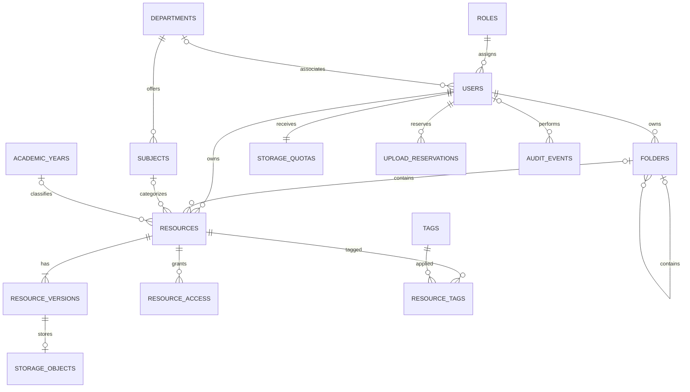

# Phase 2: Relational Domain Models, Alembic Migrations & Seeding

**Phase Number:** 02  
**Module:** Database Models & Migration Pipeline  
**Lead Agent:** **Domain Model Agent** (`Claude 3.7 Sonnet Thinking`)  
**Supporting Agents:** **Codebase Design Agent** (`Claude 3.5 Sonnet`), **Feature Executor Agent** (`Claude 3.5 Sonnet`), **Test Executor Agent** (`Claude 3.5 Sonnet`)  
**Governing Rules:** Rule 01 (Clean Architecture & Query Performance), Rule 02 (GDPR & Security Standards)  
**Status:** Ready for Execution  

---

## 1. Phase Objective & Corex Handoff

Implement the complete relational domain model in asynchronous SQLAlchemy 2.0 matching the data specifications of `phase8.md` and `phase11.md`, establish the async Alembic migration environment, and generate an idempotent database seeder.

### Handoff Contract
* **Input Context:** `phase8.md` (Entities, Constraints, Binary Quota 1 GiB / 15 GiB), `phase11.md` (Mermaid ERD), Rule 02 (GDPR consent, PII segregation, deletion cascades).
* **Output Deliverable:** 15 strongly typed SQLAlchemy models in `app/models/`, async migration runner in `alembic/`, initial migration file, and seeder in `app/db/seed.py`.
* **Acceptance Criteria:**
  1. `alembic upgrade head` runs cleanly on empty PostgreSQL instance.
  2. Foreign key constraints, unique constraints, and indexes match Phase 11 ERD.
  3. `python -m app.db.seed` runs idempotently without violating constraints.
  4. Quotas accurately seeded (Student: `1,073,741,824` bytes; Teacher: `16,106,127,360` bytes).

---

## 2. Entity Model Specifications



### Models to Implement in `app/models/`:
1. **`app/models/base.py`**:
   - `TimestampMixin`: `created_at` (timestamptz default now), `updated_at` (timestamptz default now, onupdate now).
   - `UUIDMixin`: `id: Mapped[uuid.UUID]` (primary_key, default uuid4).
2. **`app/models/user.py`**:
   - `Role`: `role_id` (PK, int), `name` (unique, indexed, e.g. "Student", "Teacher", "Administrator"), `description`.
   - `Department`: `department_id` (PK, int), `code` (unique, e.g. "CS"), `name` (unique).
   - `User`: `user_id` (PK, UUID), `role_id` (FK to Role, ondelete RESTRICT), `department_id` (FK to Department, nullable, ondelete SET NULL), `email` (unique, indexed), `full_name`, `password_hash`, `status` (Enum: "ACTIVE", "SUSPENDED", "PENDING_VERIFICATION"), `consent_given_at` (timestamptz, Rule 02 GDPR), `consent_version` (str).
   - `StudentSubject`: Junction table (`student_id` FK to User, `subject_id` FK to Subject, `enrolled_at`).
   - `TeacherSubject`: Junction table (`teacher_id` FK to User, `subject_id` FK to Subject, `assigned_at`).
3. **`app/models/folder.py`**:
   - `Folder`: `folder_id` (PK, UUID), `owner_id` (FK to User, ondelete CASCADE), `parent_folder_id` (FK to Folder, nullable, ondelete RESTRICT), `name` (str), `created_at`, `updated_at`. Index on `(owner_id, parent_folder_id)`.
4. **`app/models/resource.py`**:
   - `Subject`: `subject_id` (PK, int), `department_id` (FK), `code` (str), `name` (str), `semester` (int).
   - `AcademicYear`: `academic_year_id` (PK, int), `label` (str, unique, e.g. "2025-2026"), `start_date`, `end_date`.
   - `Resource`: `resource_id` (PK, UUID), `owner_id` (FK to User, ondelete CASCADE), `folder_id` (FK to Folder, nullable, ondelete SET NULL), `subject_id` (FK, nullable, ondelete SET NULL), `academic_year_id` (FK, nullable), `title` (str, indexed), `description` (text, nullable), `visibility` (Enum: "PRIVATE", "SHARED", "DEPARTMENT", "PUBLIC"), `status` (Enum: "PENDING_VALIDATION", "APPROVED", "REJECTED", "ARCHIVED"), `created_at`, `updated_at`.
   - `ResourceVersion`: `version_id` (PK, UUID), `resource_id` (FK to Resource, ondelete CASCADE), `uploaded_by` (FK to User, ondelete RESTRICT), `version_number` (int), `content_type` (str), `external_url` (str, nullable), `size_bytes` (bigint, default 0), `checksum` (str, nullable), `created_at`. Unique constraint `(resource_id, version_number)`.
   - `Tag`: `tag_id` (PK, int), `name` (unique, str).
   - `ResourceTag`: `resource_id` (FK), `tag_id` (FK). Composite PK `(resource_id, tag_id)`.
   - `ResourceAccess`: `access_id` (PK, UUID), `resource_id` (FK to Resource, ondelete CASCADE), `user_id` (FK to User, ondelete CASCADE), `permission` (Enum: "VIEW", "EDIT"), `granted_by` (FK to User), `created_at`.
5. **`app/models/storage.py`**:
   - `StorageObject`: `storage_object_id` (PK, UUID), `version_id` (FK to ResourceVersion, ondelete CASCADE), `object_key` (str, unique), `storage_provider` (Enum: "MINIO", "S3"), `verification_status` (Enum: "PENDING", "VERIFIED", "FAILED").
   - `StorageQuota`: `user_id` (PK, FK to User, ondelete CASCADE), `quota_bytes` (bigint), `used_bytes` (bigint, default 0), `reserved_bytes` (bigint, default 0), `updated_at`. Table check constraint: `CheckConstraint("used_bytes >= 0 AND reserved_bytes >= 0 AND (used_bytes + reserved_bytes) <= quota_bytes", name="chk_quota_boundary")`.
   - `UploadReservation`: `reservation_id` (PK, UUID), `user_id` (FK to User, ondelete CASCADE), `reserved_bytes` (bigint), `status` (Enum: "PENDING", "COMPLETED", "EXPIRED", "CANCELLED"), `expires_at` (timestamptz), `created_at`.
6. **`app/models/audit.py`**:
   - `AuditEvent`: `event_id` (PK, UUID), `actor_id` (FK to User, nullable, ondelete SET NULL), `action` (str, indexed), `entity_type` (str), `entity_id` (UUID, nullable), `details` (JSONB), `created_at`.

---

## 3. Step-by-Step Code Instructions

### Step 2.1: Implement Model Classes
Create models using modern SQLAlchemy 2.0 `Mapped` and `mapped_column` syntax.

Example: `app/models/storage.py`:
```python
import uuid
from datetime import datetime
from sqlalchemy import BigInteger, CheckConstraint, DateTime, Enum, ForeignKey, String, func
from sqlalchemy.dialects.postgresql import UUID
from sqlalchemy.orm import Mapped, mapped_column, relationship
from app.core.database import Base

class StorageQuota(Base):
    __tablename__ = "storage_quotas"
    __table_args__ = (
        CheckConstraint("used_bytes >= 0", name="chk_used_bytes_non_negative"),
        CheckConstraint("reserved_bytes >= 0", name="chk_reserved_bytes_non_negative"),
        CheckConstraint(
            "used_bytes + reserved_bytes <= quota_bytes",
            name="chk_quota_boundary"
        ),
    )

    user_id: Mapped[uuid.UUID] = mapped_column(
        UUID(as_uuid=True), ForeignKey("users.user_id", ondelete="CASCADE"), primary_key=True
    )
    quota_bytes: Mapped[int] = mapped_column(BigInteger, nullable=False)
    used_bytes: Mapped[int] = mapped_column(BigInteger, default=0, nullable=False)
    reserved_bytes: Mapped[int] = mapped_column(BigInteger, default=0, nullable=False)
    updated_at: Mapped[datetime] = mapped_column(
        DateTime(timezone=True), server_default=func.now(), onupdate=func.now(), nullable=False
    )

    user = relationship("User", back_populates="storage_quota")
```

### Step 2.2: Configure Async Alembic
1. Run `alembic init -t async alembic` in `backend/`.
2. Edit `alembic/env.py`:
   - Import `app.core.database.Base` and all models from `app.models`.
   - Set `target_metadata = Base.metadata`.
   - Replace connection URL with `settings.ASYNC_DATABASE_URI`.
3. Generate initial migration:
   ```bash
   alembic revision --autogenerate -m "0001_initial_schema"
   ```

### Step 2.3: Implement Idempotent Database Seeder (`app/db/seed.py`)
```python
import asyncio
from passlib.context import CryptContext
from sqlalchemy import select
from app.core.config import settings
from app.core.database import async_session_factory
from app.models.user import Role, Department, User
from app.models.storage import StorageQuota

pwd_context = CryptContext(schemes=["bcrypt"], deprecated="auto")

async def seed_database():
    async with async_session_factory() as session:
        async with session.begin():
            # 1. Seed Roles
            roles_data = [
                {"role_id": 1, "name": "Administrator", "description": "Full system oversight"},
                {"role_id": 2, "name": "Teacher", "description": "Academic faculty and resource creator"},
                {"role_id": 3, "name": "Student", "description": "Enrolled student"},
            ]
            for r in roles_data:
                existing = await session.scalar(select(Role).where(Role.name == r["name"]))
                if not existing:
                    session.add(Role(**r))

            # 2. Seed Departments
            dept_data = [
                {"department_id": 1, "code": "CS", "name": "Computer Science"},
                {"department_id": 2, "code": "EE", "name": "Electrical Engineering"},
            ]
            for d in dept_data:
                existing = await session.scalar(select(Department).where(Department.code == d["code"]))
                if not existing:
                    session.add(Department(**d))

            await session.flush()

            # 3. Seed Standard Demo Users
            users_data = [
                {
                    "email": "admin@amu.edu",
                    "full_name": "System Administrator",
                    "role_id": 1,
                    "quota": settings.TEACHER_DEFAULT_QUOTA_BYTES,
                },
                {
                    "email": "teacher@amu.edu",
                    "full_name": "Dr. Tariq Ahmad",
                    "role_id": 2,
                    "department_id": 1,
                    "quota": settings.TEACHER_DEFAULT_QUOTA_BYTES,  # 15 GiB
                },
                {
                    "email": "student@amu.edu",
                    "full_name": "Fatima Khan",
                    "role_id": 3,
                    "department_id": 1,
                    "quota": settings.STUDENT_DEFAULT_QUOTA_BYTES,  # 1 GiB
                },
            ]

            for u in users_data:
                existing_user = await session.scalar(select(User).where(User.email == u["email"]))
                if not existing_user:
                    user_obj = User(
                        email=u["email"],
                        full_name=u["full_name"],
                        password_hash=pwd_context.hash("amu_demo_2026!"),
                        role_id=u["role_id"],
                        department_id=u.get("department_id"),
                        status="ACTIVE",
                    )
                    session.add(user_obj)
                    await session.flush()
                    session.add(
                        StorageQuota(
                            user_id=user_obj.user_id,
                            quota_bytes=u["quota"],
                            used_bytes=0,
                            reserved_bytes=0,
                        )
                    )

        print("Database seeding completed successfully.")

if __name__ == "__main__":
    asyncio.run(seed_database())
```

---

## 4. Edge-Case & Adversarial Testing Matrix

| ID | Test Scenario | Trigger Condition | Expected Behavior |
| :--- | :--- | :--- | :--- |
| **EC-02.1** | Negative Quota or Overflow | Insert `StorageQuota` with `used_bytes = -1` or `used_bytes > quota_bytes` | PostgreSQL throws `CheckConstraint` violation `chk_quota_boundary`. |
| **EC-02.2** | Deleting Non-Empty Role | Attempt to delete `Role` when users are assigned | PostgreSQL throws `IntegrityError` due to `RESTRICT` foreign key constraint. |
| **EC-02.3** | Right-to-be-Forgotten Cascade | Delete user account | All personal `ResourceAccess`, `UploadReservation`, and `StorageQuota` cascade cleanly; files disassociated. |
| **EC-02.4** | Version Duplication | Insert duplicate `(resource_id, version_number)` | Unique constraint violation prevents version overwriting. |

---

## 5. Verification Commands

```bash
# 1. Run migrations
alembic upgrade head

# 2. Run idempotent seeding script
python -m app.db.seed

# 3. Re-run seeding to verify idempotency (must not error)
python -m app.db.seed

# 4. Verify tables and counts via psql or python test
python -c "
import asyncio
from app.core.database import async_session_factory
from sqlalchemy import select, func
from app.models.user import User

async def check():
    async with async_session_factory() as session:
        count = await session.scalar(select(func.count(User.user_id)))
        print(f'Total seeded users: {count}')

asyncio.run(check())
"
```
