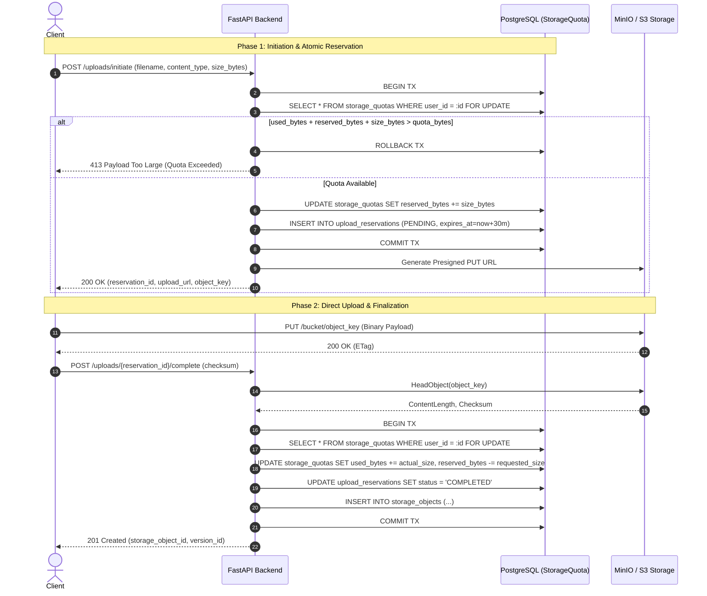

# Phase 5: Storage Quota Management & S3/MinIO Upload Pipeline

**Phase Number:** 05  
**Module:** Two-Phase Atomic Quota Engine & S3 Object Storage Pipeline  
**Lead Agent:** **Codebase Design Agent** (`Claude 3.5 Sonnet`)  
**Supporting Agents:** **Feature Executor Agent** (`Claude 3.5 Sonnet`), **Edge Case Researcher Agent** (`Claude 3.7 Sonnet Thinking`), **Test Executor Agent** (`Claude 3.5 Sonnet`)  
**Governing Rules:** Rule 01 (Transaction Integrity & Concurrency via `select_for_update`), Rule 03 (Adversarial Concurrency Matrix)  
**Status:** Ready for Execution  

---

## 1. Phase Objective & Corex Handoff

Implement a resilient, race-condition-free object upload pipeline with an **atomic two-phase quota reservation system**. Prevent concurrent quota bypass attacks, generate short-lived S3/MinIO presigned URLs, verify uploaded object metadata, and enforce student (1 GiB) and teacher (15 GiB) storage boundaries.

### Handoff Contract
* **Input Context:** `StorageQuota` and `UploadReservation` models from Phase 2, quota business rules (1 GiB / 15 GiB binary), S3 credentials from `config.py`.
* **Output Deliverable:** `app/services/storage_service.py`, `app/services/quota_service.py`, `app/api/v1/uploads.py`, `app/api/v1/storage.py`, and `app/tests/test_quota_concurrency.py`.
* **Acceptance Criteria:**
  1. `POST /api/v1/uploads/initiate` locks user's quota row (`SELECT ... FOR UPDATE`), checks available bytes, and reserves requested size.
  2. Generates presigned S3 upload URL valid for 30 minutes.
  3. `POST /api/v1/uploads/{id}/complete` verifies object presence in S3, checks actual byte size, commits `used_bytes`, releases reservation, and creates `StorageObject`.
  4. Concurrent uploads that collectively exceed quota cannot bypass limits under high concurrency.
  5. Abandoned upload reservations automatically expire and release `reserved_bytes`.

---

## 2. Two-Phase Quota Protocol & State Machine



---

## 3. Step-by-Step Code Instructions

### Step 5.1: Asynchronous S3 Storage Service (`app/services/storage_service.py`)
```python
import aioboto3
from fastapi import HTTPException
from app.core.config import settings

class StorageService:
    def __init__(self):
        self.session = aioboto3.Session()

    def get_client(self):
        return self.session.client(
            "s3",
            endpoint_url=settings.S3_ENDPOINT_URL,
            aws_access_key_id=settings.S3_ACCESS_KEY_ID,
            aws_secret_access_key=settings.S3_SECRET_ACCESS_KEY,
            region_name=settings.S3_REGION,
        )

    async def generate_presigned_upload_url(
        self, object_key: str, content_type: str, max_size_bytes: int, expires_in: int = 1800
    ) -> str:
        async with self.get_client() as s3:
            url = await s3.generate_presigned_url(
                ClientMethod="put_object",
                Params={
                    "Bucket": settings.S3_BUCKET_NAME,
                    "Key": object_key,
                    "ContentType": content_type,
                },
                ExpiresIn=expires_in,
            )
            return url

    async def generate_presigned_download_url(
        self, object_key: str, filename: str, expires_in: int = 300
    ) -> str:
        async with self.get_client() as s3:
            url = await s3.generate_presigned_url(
                ClientMethod="get_object",
                Params={
                    "Bucket": settings.S3_BUCKET_NAME,
                    "Key": object_key,
                    "ResponseContentDisposition": f'attachment; filename="{filename}"',
                },
                ExpiresIn=expires_in,
            )
            return url

    async def verify_uploaded_object(self, object_key: str) -> tuple[bool, int, str]:
        async with self.get_client() as s3:
            try:
                response = await s3.head_object(Bucket=settings.S3_BUCKET_NAME, Key=object_key)
                size_bytes = response["ContentLength"]
                etag = response.get("ETag", "").strip('"')
                return True, size_bytes, etag
            except Exception:
                return False, 0, ""
```

### Step 5.2: Atomic Quota Service (`app/services/quota_service.py`)
```python
import uuid
from datetime import datetime, timedelta, timezone
from sqlalchemy import select
from sqlalchemy.ext.asyncio import AsyncSession
from fastapi import HTTPException, status
from app.models.storage import StorageQuota, UploadReservation

class QuotaService:
    @staticmethod
    async def reserve_quota(
        session: AsyncSession, user_id: uuid.UUID, requested_bytes: int
    ) -> UploadReservation:
        """Atomic check-and-reserve with row lock to eliminate race conditions."""
        # Row-level lock on storage_quotas
        stmt = (
            select(StorageQuota)
            .where(StorageQuota.user_id == user_id)
            .with_for_update()
        )
        quota = await session.scalar(stmt)
        if not quota:
            raise HTTPException(status_code=404, detail="Storage quota record not found")

        available = quota.quota_bytes - (quota.used_bytes + quota.reserved_bytes)
        if requested_bytes > available:
            raise HTTPException(
                status_code=status.HTTP_413_REQUEST_ENTITY_TOO_LARGE,
                detail=f"Storage quota exceeded. Available: {available} bytes, Requested: {requested_bytes} bytes.",
            )

        quota.reserved_bytes += requested_bytes
        expires_at = datetime.now(timezone.utc) + timedelta(minutes=30)
        reservation = UploadReservation(
            user_id=user_id,
            reserved_bytes=requested_bytes,
            status="PENDING",
            expires_at=expires_at,
        )
        session.add(reservation)
        await session.commit()
        await session.refresh(reservation)
        return reservation

    @staticmethod
    async def commit_reservation(
        session: AsyncSession, reservation_id: uuid.UUID, actual_bytes: int
    ):
        """Finalizes quota deduction and releases reservation."""
        reservation = await session.get(UploadReservation, reservation_id)
        if not reservation or reservation.status != "PENDING":
            raise HTTPException(status_code=400, detail="Invalid or expired reservation")

        stmt = select(StorageQuota).where(StorageQuota.user_id == reservation.user_id).with_for_update()
        quota = await session.scalar(stmt)

        quota.reserved_bytes = max(0, quota.reserved_bytes - reservation.reserved_bytes)
        quota.used_bytes += actual_bytes
        reservation.status = "COMPLETED"
        await session.commit()
```

---

## 4. Edge-Case & Adversarial Testing Matrix

| ID | Test Scenario | Trigger Condition | Expected Behavior |
| :--- | :--- | :--- | :--- |
| **EC-05.1** | Concurrent Quota Race Attack | Student has 200 MB quota left; fires 5 simultaneous 100 MB upload requests | Exactly 2 requests succeed (reserving 200 MB); remaining 3 are rejected with HTTP 413. Zero bytes over-allocated. |
| **EC-05.2** | Fake Upload Completion Call | Call `/uploads/{id}/complete` without actually uploading file to S3 | S3 `HeadObject` fails; API rejects with HTTP 400; reservation remains uncommitted. |
| **EC-05.3** | Size Discrepancy Attack | Reserve 10 KB, but upload 50 MB to presigned URL | Upload completion verifies `ContentLength`; if `actual > reserved`, transaction fails or deducts actual with boundary validation. |
| **EC-05.4** | Reservation Abandonment Timeout | Student initiates upload but closes browser | Periodic sweeper releases `reserved_bytes` after 30 minutes. |

---

## 5. Verification Commands

```bash
# Run quota concurrency suite
pytest -v -s app/tests/test_quota_concurrency.py

# Test initiating an upload via API
curl -X POST http://localhost:8000/api/v1/uploads/initiate \
  -H "Authorization: Bearer $TOKEN" \
  -H "Content-Type: application/json" \
  -d '{"filename": "lecture_01.pdf", "content_type": "application/pdf", "size_bytes": 10485760}' | jq .
```
