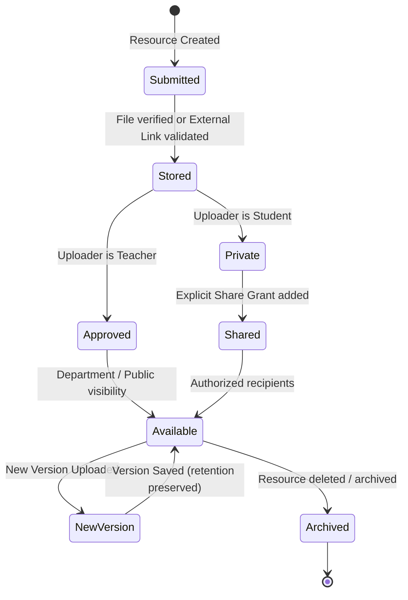

# Phase 6: Resource Lifecycle, External Links & Multi-Versioning

**Phase Number:** 06  
**Module:** Resource Lifecycle Management & Version Retention Engine  
**Lead Agent:** **Domain Model Agent** (`Claude 3.7 Sonnet Thinking`)  
**Supporting Agents:** **Feature Executor Agent** (`Claude 3.5 Sonnet`), **Test Executor Agent** (`Claude 3.5 Sonnet`), **Review Researcher Agent** (`Claude 3.7 Sonnet`)  
**Governing Rules:** Rule 01 (Clean Architecture & Services), Rule 02 (Object-Level Authorization)  
**Status:** Ready for Execution  

---

## 1. Phase Objective & Corex Handoff

Implement resource metadata management, role-based publishing policies (student uploads remain private by default; teacher uploads are automatically approved), safe external link handling (with SSRF protection), and multi-version file retention.

### Handoff Contract
* **Input Context:** Resource lifecycle state machine from `phase9.md`, API specs from `phase10.md` (10.6), models from Phase 2.
* **Output Deliverable:** `app/services/resource_service.py`, `app/schemas/resource.py`, `app/api/v1/resources.py`, and `app/tests/test_resources.py`.
* **Acceptance Criteria:**
  1. Student upload yields status `PRIVATE` and visibility `PRIVATE`.
  2. Teacher upload yields status `APPROVED` and visibility `DEPARTMENT` or `PUBLIC`.
  3. External URLs validated with strict HTTP/HTTPS protocol whitelist; private RFC 1918 IPs rejected (SSRF protection).
  4. Creating version 2 for a resource increments `version_number = 2`, preserving version 1 metadata and file storage.
  5. Generating download URL validates that requester is owner, recipient of a share grant, or enrolled in subject for approved resources.

---

## 2. Resource Lifecycle State Machine



---

## 3. Step-by-Step Code Instructions

### Step 6.1: Resource Schemas (`app/schemas/resource.py`)
```python
import uuid
from datetime import datetime
from pydantic import BaseModel, HttpUrl

class ResourceCreate(BaseModel):
    title: str
    description: str | None = None
    folder_id: uuid.UUID | None = None
    subject_id: int | None = None
    academic_year_id: int | None = None
    # For file-backed resource:
    reservation_id: uuid.UUID | None = None
    # For link-backed resource:
    external_url: HttpUrl | None = None

class ResourceVersionRead(BaseModel):
    version_id: uuid.UUID
    version_number: int
    content_type: str
    external_url: str | None = None
    size_bytes: int
    created_at: datetime

class ResourceRead(BaseModel):
    resource_id: uuid.UUID
    owner_id: uuid.UUID
    folder_id: uuid.UUID | None
    subject_id: int | None
    title: str
    description: str | None
    visibility: str
    status: str
    current_version: ResourceVersionRead | None = None
    created_at: datetime
    updated_at: datetime
```

### Step 6.2: Resource Service (`app/services/resource_service.py`)
```python
import ipaddress
import socket
import urllib.parse
import uuid
from sqlalchemy import func, select
from sqlalchemy.ext.asyncio import AsyncSession
from fastapi import HTTPException, status
from app.models.resource import Resource, ResourceVersion
from app.models.storage import StorageObject, UploadReservation
from app.models.user import User
from app.services.storage_service import StorageService

def validate_safe_url(url_str: str) -> str:
    """SSRF Prevention: Ensure URL does not resolve to private / loopback IP address."""
    parsed = urllib.parse.urlparse(url_str)
    if parsed.scheme not in ("http", "https"):
        raise HTTPException(status_code=400, detail="Invalid URL protocol. Only HTTP and HTTPS allowed.")
    hostname = parsed.hostname
    if not hostname:
        raise HTTPException(status_code=400, detail="Invalid hostname in URL.")
    try:
        ip = ipaddress.ip_address(socket.gethostbyname(hostname))
        if ip.is_private or ip.is_loopback or ip.is_link_local:
            raise HTTPException(status_code=400, detail="External links pointing to internal IPs are forbidden.")
    except Exception as exc:
        raise HTTPException(status_code=400, detail="Hostname could not be resolved.") from exc
    return url_str

class ResourceService:
    @classmethod
    async def create_resource(
        cls, session: AsyncSession, user: User, payload: dict
    ) -> Resource:
        # Determine status & visibility based on role
        if user.role.name == "Teacher" or user.role.name == "Administrator":
            status_val = "APPROVED"
            visibility_val = "DEPARTMENT"
        else:
            status_val = "PRIVATE"
            visibility_val = "PRIVATE"

        resource = Resource(
            owner_id=user.user_id,
            folder_id=payload.get("folder_id"),
            subject_id=payload.get("subject_id"),
            academic_year_id=payload.get("academic_year_id"),
            title=payload["title"].strip(),
            description=payload.get("description"),
            status=status_val,
            visibility=visibility_val,
        )
        session.add(resource)
        await session.flush()

        # Handle version creation
        if payload.get("external_url"):
            safe_url = validate_safe_url(str(payload["external_url"]))
            version = ResourceVersion(
                resource_id=resource.resource_id,
                uploaded_by=user.user_id,
                version_number=1,
                content_type="text/html",
                external_url=safe_url,
                size_bytes=0,
            )
            session.add(version)
        elif payload.get("reservation_id"):
            reservation = await session.get(UploadReservation, payload["reservation_id"])
            if not reservation or reservation.status != "COMPLETED":
                raise HTTPException(status_code=400, detail="Upload reservation must be completed first")
            
            # Find associated storage object
            storage_obj = await session.scalar(
                select(StorageObject).where(StorageObject.storage_object_id == reservation.reservation_id)
            )
            version = ResourceVersion(
                resource_id=resource.resource_id,
                uploaded_by=user.user_id,
                version_number=1,
                content_type="application/octet-stream",
                size_bytes=reservation.reserved_bytes,
            )
            session.add(version)

        await session.commit()
        await session.refresh(resource)
        return resource

    @classmethod
    async def add_version(
        cls, session: AsyncSession, user: User, resource_id: uuid.UUID, reservation_id: uuid.UUID
    ) -> ResourceVersion:
        resource = await session.get(Resource, resource_id)
        if not resource:
            raise HTTPException(status_code=404, detail="Resource not found")
        if resource.owner_id != user.user_id and user.role.name != "Administrator":
            raise HTTPException(status_code=403, detail="Permission denied")

        max_version = await session.scalar(
            select(func.max(ResourceVersion.version_number)).where(ResourceVersion.resource_id == resource_id)
        )
        next_version = (max_version or 0) + 1

        reservation = await session.get(UploadReservation, reservation_id)
        new_version = ResourceVersion(
            resource_id=resource_id,
            uploaded_by=user.user_id,
            version_number=next_version,
            content_type="application/octet-stream",
            size_bytes=reservation.reserved_bytes,
        )
        session.add(new_version)
        await session.commit()
        await session.refresh(new_version)
        return new_version
```

---

## 4. Edge-Case & Adversarial Testing Matrix

| ID | Test Scenario | Trigger Condition | Expected Behavior |
| :--- | :--- | :--- | :--- |
| **EC-06.1** | Student Upload Privacy | Student creates resource without sharing | Status is `PRIVATE`; invisible to other students and teachers. |
| **EC-06.2** | SSRF Link Attack | User submits `http://169.254.169.254/latest/meta-data` or `http://localhost:5432` | Rejected with HTTP 400 Bad Request ("internal IPs forbidden"). |
| **EC-06.3** | Version Overwrite Resistance | Concurrent version addition | Unique constraint on `(resource_id, version_number)` prevents conflicting versions. |
| **EC-06.4** | Unauthorized Download Attempt | Student B attempts `GET /resources/{id}/download` for Student A's private resource | HTTP 403 Forbidden. |

---

## 5. Verification Commands

```bash
# Run resource lifecycle tests
pytest -v app/tests/test_resources.py

# Create a resource via curl
curl -X POST http://localhost:8000/api/v1/resources \
  -H "Authorization: Bearer $TOKEN" \
  -H "Content-Type: application/json" \
  -d '{"title": "Operating Systems Syllabus", "external_url": "https://amu.ac.in/syllabus.pdf"}' | jq .
```
