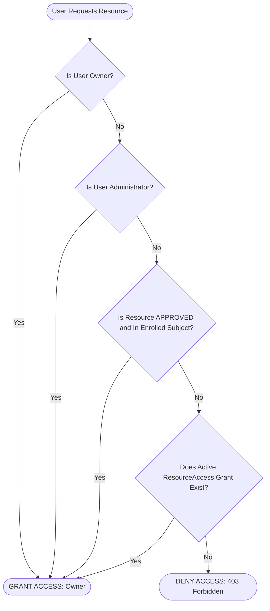

# Phase 7: Granular Sharing & Access Control

**Phase Number:** 07  
**Module:** Resource Access Grants & Multi-Tenant Authorization Engine  
**Lead Agent:** **Feature Executor Agent** (`Claude 3.5 Sonnet`)  
**Supporting Agents:** **Edge Case Researcher Agent** (`Claude 3.7 Sonnet Thinking`), **Test Executor Agent** (`Claude 3.5 Sonnet`), **Review Researcher Agent** (`Claude 3.7 Sonnet`)  
**Governing Rules:** Rule 01 (Clean Layering & Selectors), Rule 02 (Object-Level Authorization & Auditing)  
**Status:** Ready for Execution  

---

## 1. Phase Objective & Corex Handoff

Implement granular, user-level sharing controls allowing students and teachers to share private resources with specific peers or faculty without exposing them publicly. Build the central permission evaluation engine.

### Handoff Contract
* **Input Context:** `ResourceAccess` model from Phase 2, sharing workflows from `phase7.md` (7.2) and `phase10.md` (10.4.6 & 10.8.3).
* **Output Deliverable:** `app/services/sharing_service.py`, `app/schemas/sharing.py`, `app/api/v1/sharing.py`, and `app/tests/test_sharing.py`.
* **Acceptance Criteria:**
  1. Resource owners can grant `VIEW` or `EDIT` access to another user by email.
  2. Non-owners (and non-admins) cannot create or revoke share grants on a resource.
  3. `GET /api/v1/resources/shared-with-me` lists all resources explicitly granted to the calling user.
  4. Revoking a grant immediately terminates access to file downloads and metadata.

---

## 2. Permission Evaluation Logic

The access evaluation engine resolves user rights in constant time using the following hierarchy:



---

## 3. Step-by-Step Code Instructions

### Step 7.1: Sharing Schemas (`app/schemas/sharing.py`)
```python
import uuid
from datetime import datetime
from pydantic import BaseModel, EmailStr

class ShareGrantCreate(BaseModel):
    grantee_email: EmailStr
    permission: str = "VIEW"  # "VIEW" | "EDIT"

class ShareGrantRead(BaseModel):
    access_id: uuid.UUID
    resource_id: uuid.UUID
    user_id: uuid.UUID
    grantee_email: str
    grantee_name: str
    permission: str
    granted_by: uuid.UUID
    created_at: datetime
```

### Step 7.2: Sharing Service & Permission Resolver (`app/services/sharing_service.py`)
```python
import uuid
from sqlalchemy import select
from sqlalchemy.ext.asyncio import AsyncSession
from fastapi import HTTPException, status
from app.models.resource import Resource, ResourceAccess
from app.models.user import User

class SharingService:
    @staticmethod
    async def can_access_resource(
        session: AsyncSession, user: User, resource_id: uuid.UUID, required_permission: str = "VIEW"
    ) -> bool:
        resource = await session.get(Resource, resource_id)
        if not resource:
            return False

        # 1. Owner always has full access
        if resource.owner_id == user.user_id:
            return True

        # 2. Administrator has full oversight
        if user.role.name == "Administrator":
            return True

        # 3. Approved institutional resource
        if resource.status == "APPROVED" and required_permission == "VIEW":
            # Accessible if public or matching user's department
            if resource.visibility in ("PUBLIC", "DEPARTMENT"):
                return True

        # 4. Explicit ResourceAccess grant
        stmt = (
            select(ResourceAccess)
            .where(
                ResourceAccess.resource_id == resource_id,
                ResourceAccess.user_id == user.user_id,
            )
        )
        grant = await session.scalar(stmt)
        if grant:
            if required_permission == "VIEW":
                return True
            if required_permission == "EDIT" and grant.permission == "EDIT":
                return True

        return False

    @classmethod
    async def grant_access(
        cls, session: AsyncSession, actor: User, resource_id: uuid.UUID, payload: dict
    ) -> ResourceAccess:
        resource = await session.get(Resource, resource_id)
        if not resource:
            raise HTTPException(status_code=404, detail="Resource not found")
        if resource.owner_id != actor.user_id and actor.role.name != "Administrator":
            raise HTTPException(status_code=403, detail="Only resource owner or administrator can share this resource")

        # Find grantee
        grantee = await session.scalar(select(User).where(User.email == payload["grantee_email"]))
        if not grantee:
            raise HTTPException(status_code=404, detail="Target user with given email not found")

        if grantee.user_id == actor.user_id:
            raise HTTPException(status_code=400, detail="Cannot share resource with yourself")

        # Check existing grant
        existing = await session.scalar(
            select(ResourceAccess).where(
                ResourceAccess.resource_id == resource_id,
                ResourceAccess.user_id == grantee.user_id,
            )
        )
        if existing:
            existing.permission = payload["permission"]
            await session.commit()
            return existing

        grant = ResourceAccess(
            resource_id=resource_id,
            user_id=grantee.user_id,
            permission=payload["permission"],
            granted_by=actor.user_id,
        )
        session.add(grant)
        await session.commit()
        await session.refresh(grant)
        return grant

    @classmethod
    async def revoke_access(
        cls, session: AsyncSession, actor: User, resource_id: uuid.UUID, grant_id: uuid.UUID
    ):
        grant = await session.get(ResourceAccess, grant_id)
        if not grant or grant.resource_id != resource_id:
            raise HTTPException(status_code=404, detail="Share grant not found")

        resource = await session.get(Resource, resource_id)
        if resource.owner_id != actor.user_id and actor.role.name != "Administrator":
            raise HTTPException(status_code=403, detail="Permission denied")

        await session.delete(grant)
        await session.commit()
```

---

## 4. Edge-Case & Adversarial Testing Matrix

| ID | Test Scenario | Trigger Condition | Expected Behavior |
| :--- | :--- | :--- | :--- |
| **EC-07.1** | Non-Owner Shares Resource | Student B (granted VIEW) attempts to call `/share` to grant Student C | HTTP 403 Forbidden. Only owner or admin can share. |
| **EC-07.2** | Self-Sharing Attempt | User attempts to share file with their own email | HTTP 400 Bad Request ("Cannot share with yourself"). |
| **EC-07.3** | Immediate Revocation Effect | Grant is revoked while user has open browser session | Next download or metadata request immediately returns HTTP 403 Forbidden. |
| **EC-07.4** | Non-Existent Grantee Email | Submitting arbitrary unverified email | HTTP 404 User not found; no phantom records inserted. |

---

## 5. Verification Commands

```bash
# Run sharing tests
pytest -v app/tests/test_sharing.py

# Share resource with peer
curl -X POST http://localhost:8000/api/v1/resources/$RESOURCE_ID/share \
  -H "Authorization: Bearer $TOKEN" \
  -H "Content-Type: application/json" \
  -d '{"grantee_email": "teacher@amu.edu", "permission": "VIEW"}' | jq .
```
