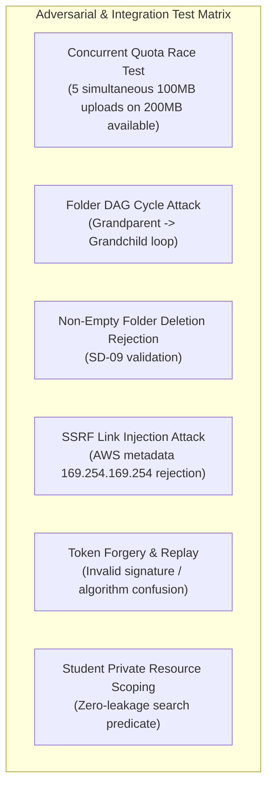

# Phase 10: Edge-Case Hardening, Automated Testing & Production Packaging

**Phase Number:** 10  
**Module:** Adversarial QA, Full Test Suite Execution & Containerization  
**Lead Agent:** **Edge Case Researcher Agent** (`Claude 3.7 Sonnet Thinking`)  
**Supporting Agents:** **Test Executor Agent** (`Claude 3.5 Sonnet`), **Deployment Agent** (`GPT-4o`), **Review Researcher Agent** (`Claude 3.7 Sonnet`)  
**Governing Rules:** Rule 01 (Clean Architecture), Rule 02 (Zero Hardcoded Secrets), Rule 03 (Adversarial Edge Case Testing & QA Standards)  
**Status:** Ready for Execution  

---

## 1. Phase Objective & Corex Handoff

Conduct comprehensive adversarial testing, execute the complete Pytest integration suite against real PostgreSQL and MinIO test instances (Rule 03: zero database mocking in integration suites), verify security hygiene, and produce production-ready multi-stage Docker configurations.

### Handoff Contract
* **Input Context:** Completed modules from Phases 1 through 9, testing requirements from Rule 03, deployment specifications from `phase10.md` (10.11 & 10.12).
* **Output Deliverable:** Comprehensive test suite in `backend/app/tests/`, multi-stage `backend/Dockerfile`, `docker-compose.prod.yml`, and test run report.
* **Acceptance Criteria:**
  1. 100% test pass on all unit and integration test suites.
  2. Test code coverage > 85% across all service and repository layers.
  3. Zero database mocking in integration tests: tests run against real PostgreSQL test instance with full constraints enabled.
  4. Docker build produces a hardened, non-root container image running Gunicorn with Uvicorn worker threads.

---

## 2. Adversarial Test Matrix (Rule 03 Compliance)



---

## 3. Step-by-Step Code Instructions

### Step 10.1: Pytest Test Configuration (`app/tests/conftest.py`)
Ensure tests use real PostgreSQL transactions with automatic rollbacks between test runs:

```python
import asyncio
from collections.abc import AsyncGenerator
import pytest_asyncio
from httpx import ASGITransport, AsyncClient
from sqlalchemy.ext.asyncio import AsyncSession, async_sessionmaker, create_async_engine
from app.core.config import settings
from app.core.database import Base, get_db_session
from app.main import app

test_engine = create_async_engine(settings.ASYNC_DATABASE_URI, echo=False)
test_session_factory = async_sessionmaker(bind=test_engine, class_=AsyncSession, expire_on_commit=False)

@pytest_asyncio.fixture(scope="session")
async def setup_test_db():
    async with test_engine.begin() as conn:
        await conn.run_sync(Base.metadata.create_all)
    yield
    async with test_engine.begin() as conn:
        await conn.run_sync(Base.metadata.drop_all)

@pytest_asyncio.fixture
async def db_session(setup_test_db) -> AsyncGenerator[AsyncSession, None]:
    async with test_session_factory() as session:
        yield session
        await session.rollback()

@pytest_asyncio.fixture
async def async_client(db_session: AsyncSession) -> AsyncGenerator[AsyncClient, None]:
    async def override_get_db():
        yield db_session

    app.dependency_overrides[get_db_session] = override_get_db
    transport = ASGITransport(app=app)
    async with AsyncClient(transport=transport, base_url="http://test") as client:
        yield client
    app.dependency_overrides.clear()
```

### Step 10.2: Concurrency & Race Condition Test (`app/tests/test_quota_concurrency.py`)
```python
import asyncio
import uuid
import pytest
from app.core.database import async_session_factory
from app.models.storage import StorageQuota
from app.services.quota_service import QuotaService

@pytest.mark.asyncio
async def test_concurrent_quota_reservations_cannot_exceed_limit():
    user_id = uuid.uuid4()
    # 1. Setup user quota: 200 MB limit
    async with async_session_factory() as session:
        quota = StorageQuota(
            user_id=user_id,
            quota_bytes=200 * 1024 * 1024,  # 200 MiB
            used_bytes=0,
            reserved_bytes=0,
        )
        session.add(quota)
        await session.commit()

    # 2. Fire 5 concurrent reservation requests of 100 MB each
    # Expected: exactly 2 succeed (totaling 200 MB); 3 fail with HTTP 413
    async def attempt_reservation():
        async with async_session_factory() as s:
            try:
                res = await QuotaService.reserve_quota(s, user_id, 100 * 1024 * 1024)
                return True
            except Exception:
                return False

    results = await asyncio.gather(*[attempt_reservation() for _ in range(5)])

    successes = results.count(True)
    failures = results.count(False)

    assert successes == 2, f"Expected exactly 2 successes, got {successes}"
    assert failures == 3, f"Expected exactly 3 failures, got {failures}"

    # Verify database state has not over-allocated
    async with async_session_factory() as session:
        q = await session.get(StorageQuota, user_id)
        assert q.reserved_bytes == 200 * 1024 * 1024
        assert q.used_bytes == 0
```

### Step 10.3: Multi-Stage Production `backend/Dockerfile`
```dockerfile
# Stage 1: Build dependencies
FROM python:3.12-slim AS builder

WORKDIR /app
RUN apt-get update && apt-get install -y --no-install-recommends gcc libpq-dev && rm -rf /var/lib/apt/lists/*

COPY pyproject.toml README.md ./
RUN pip install --no-cache-dir --upgrade pip && \
    pip install --no-cache-dir .

# Stage 2: Runtime Image
FROM python:3.12-slim AS runner

WORKDIR /app

RUN apt-get update && apt-get install -y --no-install-recommends libpq5 curl && \
    rm -rf /var/lib/apt/lists/* && \
    useradd -u 1001 -m -s /bin/bash appuser

COPY --from=builder /usr/local/lib/python3.12/site-packages /usr/local/lib/python3.12/site-packages
COPY --from=builder /usr/local/bin /usr/local/bin

COPY . .

# Secure non-root ownership
RUN chown -R appuser:appuser /app
USER appuser

EXPOSE 8000

HEALTHCHECK --interval=10s --timeout=5s --retries=3 \
  CMD curl -f http://localhost:8000/healthz || exit 1

CMD ["gunicorn", "app.main:app", "-w", "4", "-k", "uvicorn.workers.UvicornWorker", "-b", "0.0.0.0:8000"]
```

---

## 4. Verification & Testing Checklist

```bash
# 1. Run full test suite with coverage report
cd backend
pytest -v --cov=app --cov-report=term-missing app/tests/

# 2. Linting and formatting check
ruff check app/
ruff format --check app/

# 3. Type safety check
mypy app/

# 4. Build and test production Docker image
docker build -t amu-resource-backend:latest .
docker run --rm -d --name amu-test -p 8000:8000 --env-file .env amu-resource-backend:latest
sleep 3
curl -s http://localhost:8000/healthz | jq .
docker stop amu-test
```
