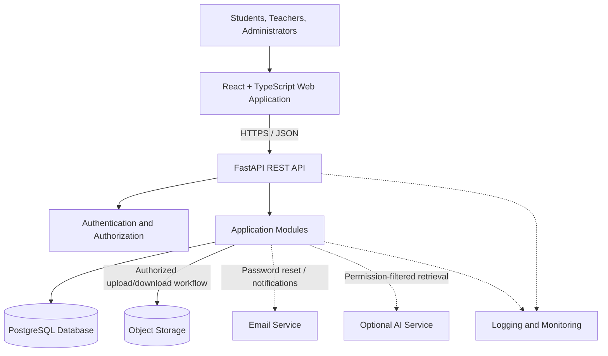
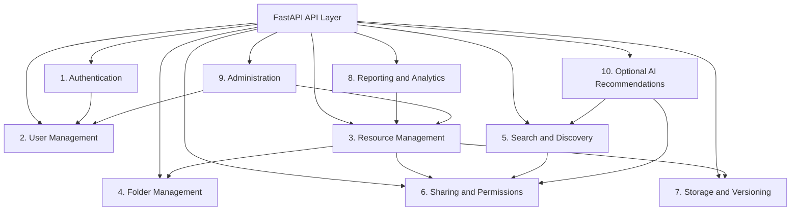
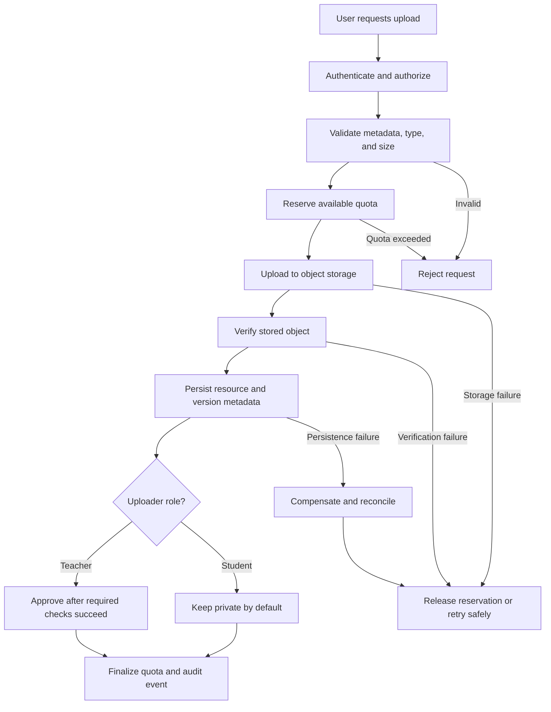
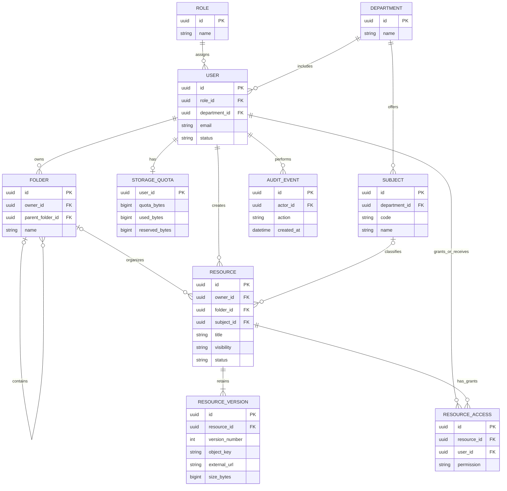
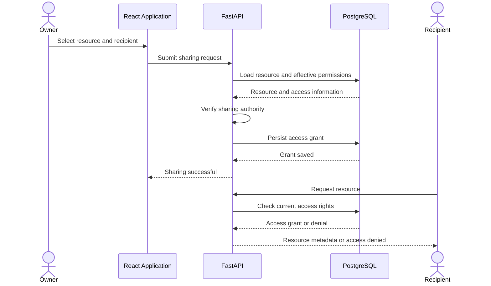

# Phase 10 — System Design

## AMU Cloud-Based Academic Resource Management System

This phase converts the requirements and analysis models from the previous phases into a technical blueprint for implementation. It defines the system architecture, module responsibilities, component interactions, data storage, security boundaries, and key workflows.

The design follows three principles:

1. Traceability: Every major component and module must support an identified requirement or analysis finding.
2. Separation of concerns: The user interface, business logic, database, file storage, and external services have clearly defined responsibilities.
3. Practical implementation: Start with a modular monolith rather than microservices, keeping the system maintainable for an academic project while allowing future expansion.

The system is intended to complement AMU's existing academic platforms, not replace Moodle, SAMARTH-ERP, or the e-Library. Integrations with those platforms would require separate feasibility checks and authorization.

## 10.1 System design scope and assumptions

| Design area          | Decision                                                   |
| -------------------- | ---------------------------------------------------------- |
| Frontend             | React with TypeScript                                      |
| Backend              | FastAPI with Python                                        |
| Database             | PostgreSQL                                                 |
| File storage         | S3-compatible object storage                               |
| API style            | REST API with versioned endpoints                          |
| Architecture         | Modular monolith                                           |
| Authentication       | Secure login, session management, role-based authorization |
| User roles           | Student, Teacher, Administrator; one role per user         |
| Student upload quota | 1 GB                                                       |
| Teacher upload quota | 15 GB                                                      |
| Search               | PostgreSQL full-text search and metadata filters           |
| AI capabilities      | Optional future recommendation and analytics module        |
| Deployment           | Docker-based deployment on a selected cloud provider       |

These are the proposed design decisions for the project, not claims that the system has already been implemented or deployed.

The initial release will manage uploaded files and external links, nested folders, metadata, search, controlled sharing, version history, and storage quotas. Physical lab-asset tracking and direct integrations with university systems are outside the initial release.

## 10.2 Requirements traceability

Traceability connects the problems identified during analysis to specific modules and design decisions. The IDs below are proposed identifiers for Phase 10 and can be aligned with the final requirements document.

| ID    | Requirement or analysis finding                                                    | Design response                                                           |
| ----- | ---------------------------------------------------------------------------------- | ------------------------------------------------------------------------- |
| SD-01 | Resources are scattered across multiple platforms                                  | Central resource repository and external-link support                     |
| SD-02 | Resources are difficult to find                                                    | Global search, filters, metadata, and breadcrumbs                         |
| SD-03 | Files lack consistent organization                                                 | Nested folders and subject-related metadata                               |
| SD-04 | Users have different permissions                                                   | Authentication, one-role-per-user model, and resource-level authorization |
| SD-05 | Student uploads must remain private by default                                     | Private visibility and explicit sharing grants                            |
| SD-06 | Teachers' uploads are automatically approved only after validation and persistence | Validated upload workflow and teacher-specific publication rules          |
| SD-07 | Users have limited storage quotas                                                  | Quota management, upload reservations, and retained-version accounting    |
| SD-08 | Users need previous versions                                                       | Resource version history and retained object storage                      |
| SD-09 | Non-empty folders cannot be deleted                                                | Server-side folder deletion validation                                    |
| SD-10 | Administrators manage users and resources                                          | Administration module and audit events                                    |
| SD-11 | Resource information may be needed for decisions                                   | Reporting and analytics module                                            |
| SD-12 | Future discovery could benefit from AI                                             | Optional recommendation module with permission-aware retrieval            |

This mapping should eventually be expanded to include the exact requirement IDs, use cases, process models, and data-analysis findings from the earlier phases.

## 10.3 System architecture

The system will use a three-tier application architecture, supplemented by external object storage and optional external services.

- Presentation tier: React application used by students, teachers, and administrators.
- Application tier: FastAPI backend responsible for authentication, business rules, permissions, resource management, and APIs.
- Data tier: PostgreSQL stores structured metadata, while object storage holds uploaded file contents.
- External services: Email delivery, optional AI services, and any approved university integrations.

### 10.3.1 High-level architecture diagram



Figure 10.1 — Proposed logical system architecture. Dashed connections represent optional integrations or supporting services.

### 10.3.2 Component responsibilities

| Component                        | Responsibility                                                                                    |
| -------------------------------- | ------------------------------------------------------------------------------------------------- |
| React web application            | Displays pages, forms, resource lists, folder navigation, search, and upload progress             |
| FastAPI REST API                 | Receives requests, validates inputs, enforces business rules, and returns responses               |
| Authentication and authorization | Identifies users, validates sessions, checks roles, and evaluates resource permissions            |
| Application modules              | Implement resource, folder, sharing, versioning, storage, reporting, and administration logic     |
| PostgreSQL                       | Stores users, roles, folders, resource metadata, versions, permissions, quotas, and audit records |
| Object storage                   | Stores file bytes independently of the relational database                                        |
| Email service                    | Sends account recovery and other approved notifications                                           |
| Optional AI service              | Supports recommendations or semantic discovery only when enabled and authorized                   |
| Logging and monitoring           | Records application errors, performance information, security events, and operational health      |

### 10.3.3 How a request moves through the system

Consider a student searching for a database management systems lab manual.

1. The student enters a search query in the React application.
2. The frontend sends a request to the FastAPI search endpoint.
3. The backend authenticates the user and determines the user's access rights.
4. The search module queries PostgreSQL using the search text and selected filters.
5. The backend excludes resources the student is not allowed to discover.
6. The API returns authorized resource metadata, such as the title, subject, file type, and modification date.
7. The frontend displays the results.
8. If the student opens a result, the backend checks access again before allowing a preview or download.

Important design rule: Hiding a resource in the frontend is not sufficient security. The backend must enforce permissions on every protected operation.

### 10.3.4 Architectural style

The initial system will be a modular monolith. All application modules run within one backend application but maintain clear boundaries.

This approach is appropriate because it:

- Reduces deployment and infrastructure complexity.
- Makes database transactions easier to manage.
- Supports faster development and testing.
- Allows the system to evolve without introducing distributed-system complexity prematurely.

The modules can be separated into services later if real usage, scaling requirements, or independent deployment needs justify doing so.

## 10.4 Module design

The backend will be divided into the following logical modules. Each module owns a specific set of responsibilities, while shared rules—especially authentication, permissions, and auditing—apply across the system.



Figure 10.2 — Logical module dependencies. The diagram shows responsibility boundaries, not separate deployable services.

### 10.4.1 Authentication module

Purpose: Ensure that only authenticated users can access protected features and that user sessions are handled securely.

Main responsibilities

- Login and logout.
- Password hashing and verification.
- Session creation, expiry, and revocation.
- Password recovery.
- Authentication status checks.
- Protection against brute-force login attempts.
- Optional integration with university identity services if formally authorized.

Inputs: Login credentials, logout requests, password-reset requests, session credentials.

Outputs: Authenticated session, authentication status, or a suitable error response.

Main data: `User`, session records, password-reset tokens or equivalent short-lived recovery records.

Key design rules

- Never store plaintext passwords.
- Assign a user's role on the server; do not trust a role submitted by the browser.
- Use secure, `HttpOnly`, appropriately configured `SameSite` cookies for browser sessions, with CSRF protection where required.
- Apply login rate limits and short-lived, single-use password-reset tokens.
- Revoke sessions when appropriate, such as after account suspension or password changes.

Related requirements: SD-04, SD-10.

### 10.4.2 Student and user management module

Purpose: Maintain user profiles and the academic relationships needed to classify and access resources.

Main responsibilities

- Create and update user profiles.
- Maintain department and subject associations.
- Manage account status.
- Store each user's single assigned role.
- Associate teachers with the subjects they are authorized to manage.
- Associate students with relevant academic subjects or groups.
- Enforce storage quota defaults according to role.
- Support authorized administrative changes.

Proposed user fields

`id`, `name`, `email`, `password_hash`, `role_id`, `department_id`, `status`, `created_at`, `updated_at`.

A separate `Role` table can contain Student, Teacher, and Administrator. The `User.role_id` field references exactly one role, rather than a many-to-many role assignment.

Key design rules

- A suspended account must not continue using active sessions.
- Changing a role must be an authorized administrative operation.
- Subject membership and teacher assignment must be checked before granting subject-level access.
- Quota values should be managed centrally rather than hardcoded in frontend components.

Related requirements: SD-04, SD-07, SD-10.

### 10.4.3 Resource management module

Purpose: Provide the central functionality for creating, describing, updating, and accessing academic resources.

Supported resources

- Uploaded files, such as PDFs, documents, images, and other permitted formats.
- External links to academic material hosted elsewhere.

Main responsibilities

- Create resource records and metadata.
- Edit titles, descriptions, subjects, tags, and other permitted metadata.
- Move resources between folders.
- Maintain resource ownership and visibility.
- Create new versions when content is updated.
- Validate resource state before publication.
- Coordinate deletion and retention rules.

Proposed metadata

`id`, `title`, `description`, `resource_type`, `owner_id`, `folder_id`, `subject_id`, `academic_year_id`, `visibility`, `status`, `created_at`, `updated_at`.

The academic year is proposed as an independent classification field. It should not depend solely on folder names.

Key design rules

- A new version must not silently overwrite a retained previous version.
- Editing metadata is different from uploading a new version.
- Student-created resources remain private until explicitly shared.
- Teacher uploads become approved only after the required validation, file-storage, and metadata-persistence steps succeed.
- Resource deletion must account for permissions, retained versions, and storage cleanup.

Related requirements: SD-01, SD-03, SD-05, SD-06, SD-08.

### 10.4.4 Folder management module

Purpose: Give users a familiar hierarchical organization system inspired by cloud-drive interfaces.

Main responsibilities

- Create and rename folders.
- Navigate nested folders.
- List folders and resources within a folder.
- Move permitted resources and folders.
- Provide breadcrumb navigation.
- Enforce folder access rules.
- Prevent deletion of non-empty folders.

Proposed data structure

A `Folder` record includes:

- `id`
- `name`
- `owner_id`
- `parent_folder_id` — nullable, for root folders
- `created_at`
- `updated_at`

The `parent_folder_id` references another folder. This supports nested folders without creating a separate database table for each hierarchy level.

Key design rules

1. A folder cannot be moved into itself or one of its descendants.
2. A folder can be deleted only when it contains no resources and no subfolders.
3. Folder access must not accidentally expose resources that the current user cannot access.
4. Folder names and paths are organizational aids, not substitutes for subject and academic-year metadata.
5. Move operations must validate both source and destination permissions.

Related requirements: SD-02, SD-03, SD-09.

### 10.4.5 Search and discovery module

Purpose: Make resources discoverable even when users do not know the original folder location or filename.

Main responsibilities

- Global search across authorized resources.
- Search by title, description, tags, and selected metadata.
- Filter by department, subject, semester, academic year, resource type, uploader, and date.
- Sort by relevance, name, modification date, or other supported fields.
- Support pagination.
- Provide recent and starred resource views if included in the final scope.

Initial implementation: PostgreSQL full-text search and indexed metadata queries.

A dedicated search engine is not required for the first release. It can be considered later if measured search latency, scale, or ranking needs justify it.

Key design rules

- Apply authorization constraints before returning search results.
- Do not expose private resource titles, filenames, owners, or metadata through search suggestions or result counts.
- Validate filters and sort parameters.
- Keep search filters and pagination in the URL where practical, so users can bookmark or share a search page without exposing private results.

Related requirements: SD-01, SD-02, SD-03, SD-05.

### 10.4.6 Sharing and permissions module

Purpose: Allow resource owners and authorized users to grant controlled access to academic material.

Potential sharing scopes

- Specific users.
- Authorized subject or academic groups.
- Wider audiences, only where permitted by policy.

These scopes are proposed options; the final policy must determine which groups can be used and who can grant access.

Main responsibilities

- Create and revoke sharing grants.
- Maintain access lists.
- Enforce permissions for viewing, downloading, and sharing.
- Support a Shared with Me view.
- Prevent unauthorized users from discovering or accessing private resources.
- Apply permissions consistently to API requests and file downloads.

Suggested permission model

| Permission | Meaning                                                              |
| ---------- | -------------------------------------------------------------------- |
| View       | Read resource metadata and, when permitted, preview its contents     |
| Download   | Obtain the file contents                                             |
| Share      | Grant access to other authorized users                               |
| Edit       | Modify resource metadata or content, subject to ownership and policy |
| Delete     | Remove a resource, subject to authorization and retention rules      |

The permissions should be enforced by the backend. A user's role alone does not automatically grant access to every resource.

Related requirements: SD-04, SD-05, SD-10.

### 10.4.7 Storage and versioning module

Purpose: Store file contents reliably, manage upload workflows, and enforce user storage limits.

Main responsibilities

- Initiate and complete uploads.
- Validate permitted file types and individual file-size limits.
- Reserve quota before an upload proceeds.
- Verify successful object storage before finalizing metadata.
- Track the size of every retained file version.
- Create restricted download links after authorization.
- Release reservations when uploads fail.
- Support safe cleanup and reconciliation of incomplete operations.

Storage separation

- PostgreSQL stores metadata, ownership, version numbers, storage keys, and size information.
- Object storage stores the actual file bytes.
- External-link resources store validated URL information and do not consume uploaded-file storage quota.

Quota rules

- Student quota: 1 GB.
- Teacher quota: 15 GB.
- All retained file versions count toward quota.
- External links do not count as uploaded file bytes.

For example, if a user retains a 100 MB original and a 120 MB replacement as separate versions, the quota usage is 220 MB.

Upload workflow



Figure 10.3 — Uploaded-file workflow. Failed operations must not leave incorrect quota totals or publicly accessible orphaned files.

Key design rules

- Quota reservation must be concurrency-safe, so simultaneous uploads cannot exceed the limit.
- A file must not become available merely because the browser reports that an upload finished.
- The backend must verify the stored object and persist the associated metadata.
- Presigned URLs must be short-lived and restricted to the intended operation and object.
- If object storage succeeds but database persistence fails, the system must compensate or reconcile the orphaned object.
- The maximum file size and allowed file types still need to be specified.

Related requirements: SD-06, SD-07, SD-08.

### 10.4.8 Reporting and analytics module

Purpose: Provide administrators and authorized staff with a reliable overview of resource usage and system activity.

Potential reports

- Number of resources by subject, department, and resource type.
- Number of active users by role.
- Storage consumption by user and role.
- Upload and download activity over time.
- Most frequently accessed resources.
- Failed uploads and storage quota rejections.
- Resource creation and update trends.
- Resources with missing or incomplete metadata.

Data sources

The reporting module reads approved data from resource, user, version, quota, and audit records. It should not independently change the underlying resource data.

Key design rules

- Restrict reports to authorized users.
- Use aggregated queries and pagination for large result sets.
- Avoid exposing private resource details in administrative reports unless the administrator is authorized to see them.
- Define which activities are logged before treating the resulting metrics as complete.

Initial scope: Basic administrative reports and storage usage. Advanced analytics can be added later.

Related requirements: SD-10, SD-11.

### 10.4.9 Administration module

Purpose: Give administrators the tools to manage accounts, resources, and system-wide policies.

Main responsibilities

- Manage user accounts and their assigned roles.
- Create, edit, and remove resources as authorized.
- Manage department, subject, and academic-year records.
- Review operational errors and relevant audit events.
- Apply account suspension and access revocation.
- View system usage and storage reports.
- Maintain configurable upload and resource policies where authorized.

Key design rules

- Administrative actions must be checked on the backend.
- Important actions, such as role changes, resource removals, and account suspensions, should create audit events.
- Administrators must not bypass storage consistency rules when removing resources.
- Administrative permissions must be explicit and separate from ordinary teacher permissions.

Related requirements: SD-04, SD-10.

### 10.4.10 Recommendation and AI analytics module

Purpose: Improve academic resource discovery and reduce the effort required to locate relevant materials.

This is an optional module. The core resource management system should remain useful even if AI is disabled or unavailable.

Potential AI capabilities

| Capability               | Purpose                                                                   | Possible implementation                          |
| ------------------------ | ------------------------------------------------------------------------- | ------------------------------------------------ |
| Semantic search          | Find relevant material even when the query does not match the exact title | Embeddings and similarity search                 |
| Resource recommendations | Suggest related notes, lab manuals, or previous-year questions            | Content similarity and subject metadata          |
| Automatic tagging        | Suggest topics, subject labels, or keywords                               | Text classification or language models           |
| Metadata assistance      | Suggest a title or description based on uploaded content                  | Document extraction and language models          |
| Duplicate detection      | Identify likely duplicate uploads                                         | File hashes and, optionally, semantic similarity |
| Search assistance        | Interpret natural-language questions and retrieve authorized resources    | Retrieval-augmented generation (RAG)             |

Proposed processing flow

1. A user submits a query or requests recommendations.
2. The backend authenticates the user.
3. The system determines which resources that user is allowed to discover.
4. Search or recommendation logic retrieves candidates from the permitted resource set.
5. Optional AI processing ranks or summarizes the permitted candidates.
6. The backend validates the result and returns authorized resource references.
7. The frontend displays results with links to the original resources.

Security and quality requirements

- AI must not expand the user's permissions.
- Private student uploads must not appear in recommendations for other users unless explicitly shared with them.
- AI-generated metadata should be treated as a suggestion until accepted or approved under the applicable workflow.
- External content and uploaded documents must be treated as untrusted data; their contents must not be allowed to override application instructions or authorization policies.
- Sensitive academic files should not be sent to an external AI provider without an appropriate privacy, retention, and data-processing review.
- Recommendations should link back to the original resource and respect current access permissions.

Recommended development order: Implement conventional search and metadata filters first. Introduce AI capabilities only after access control, metadata quality, and resource retrieval are reliable.

Related requirements: SD-02, SD-05, SD-11, SD-12.

### 10.4.11 Notifications module

Purpose: Communicate important system events without requiring users to repeatedly check the application.

Potential notifications

- Password recovery.
- Sharing invitations or access changes.
- Upload completion or failure.
- Administrative account changes.
- Other notifications approved for the project.

Notifications should be generated from successful application events, not merely from a frontend button click. Email delivery failures must not corrupt the underlying resource transaction.

For the first release, password recovery and essential sharing notifications may be sufficient. In-app notifications can be introduced later.

## 10.5 Database and data-storage design

The database design follows the analysis requirements: single-role users, nested folders, private-by-default student uploads, retained versions, storage quotas, and controlled sharing.

### 10.5.1 Proposed entity relationships



Figure 10.4 — Initial entity-relationship model. This is a logical starting point; the final schema must include constraints, indexes, timestamps, academic-year records, and any approved group-based sharing entities.

### 10.5.2 Main data entities

| Entity              | Purpose                                                             |
| ------------------- | ------------------------------------------------------------------- |
| `User`              | Account, profile, role, and account status                          |
| `Role`              | Defines Student, Teacher, and Administrator                         |
| `Department`        | Organizes academic departments                                      |
| `Subject`           | Supports subject-based classification                               |
| `AcademicYear`      | Separately classifies resources by academic year, if required       |
| `Folder`            | Represents nested resource organization                             |
| `Resource`          | Stores stable resource identity and current metadata                |
| `ResourceVersion`   | Records each retained file or link version                          |
| `StorageQuota`      | Tracks quota, used bytes, and reserved bytes                        |
| `ResourceAccess`    | Stores explicit user-level access grants                            |
| `AuditEvent`        | Records important security and administrative actions               |
| `UploadReservation` | Tracks an upload's temporary quota reservation and completion state |

The ER diagram omits some operational fields and supporting tables to keep it readable. `UploadReservation` should be added to the detailed schema because upload failures and concurrent uploads must be handled safely.

### 10.5.3 Important database constraints

1. Each user references exactly one role.
2. User email addresses must be unique under the chosen normalization policy.
3. A resource version represents either a stored file or an external link, never both.
4. File versions have a non-negative byte size and a valid object-storage key.
5. External-link versions have a validated URL and do not count toward uploaded-file quota.
6. A resource's version number must be unique within that resource.
7. A folder cannot be its own parent, and application logic must prevent longer folder cycles.
8. A folder cannot be deleted while it contains resources or subfolders.
9. Sharing grants must not accidentally duplicate or contradict effective permissions.
10. Quota updates must be transactional and safe under concurrent requests.

### 10.5.4 Database versus object storage

The relational database should not hold the binary contents of every uploaded document. Instead:

- PostgreSQL stores structured records and references.
- Object storage stores file bytes.
- The backend controls the association between each file version and its storage object.
- The browser receives access to the file only after the backend checks the relevant permissions.

This separation keeps metadata queries efficient and allows file storage to scale independently.

## 10.6 API design

The frontend and backend communicate through versioned REST endpoints. FastAPI can publish an OpenAPI specification for documentation and later API testing.

The following endpoint names are proposed contracts, not existing endpoints.

| Module         | Example endpoint                                 | Purpose                                            |
| -------------- | ------------------------------------------------ | -------------------------------------------------- |
| Authentication | `POST /api/v1/auth/login`                        | Authenticate a user                                |
| Authentication | `POST /api/v1/auth/logout`                       | End the current session                            |
| Authentication | `GET /api/v1/auth/me`                            | Retrieve the current user's profile and role       |
| Users          | `GET /api/v1/users/me`                           | Retrieve the user's own profile                    |
| Folders        | `POST /api/v1/folders`                           | Create a folder                                    |
| Folders        | `GET /api/v1/folders/{id}/contents`              | List accessible folder contents                    |
| Folders        | `PATCH /api/v1/folders/{id}`                     | Rename or update folder metadata                   |
| Resources      | `POST /api/v1/resources`                         | Create resource metadata, such as an external link |
| Resources      | `GET /api/v1/resources/{id}`                     | Retrieve authorized resource details               |
| Resources      | `PATCH /api/v1/resources/{id}`                   | Update permitted metadata                          |
| Versions       | `GET /api/v1/resources/{id}/versions`            | List retained versions                             |
| Sharing        | `POST /api/v1/resources/{id}/share`              | Grant access                                       |
| Sharing        | `DELETE /api/v1/resources/{id}/share/{grant_id}` | Revoke a grant                                     |
| Search         | `GET /api/v1/search?q=...`                       | Search authorized resources                        |
| Storage        | `GET /api/v1/storage/quota`                      | Retrieve quota usage                               |
| Uploads        | `POST /api/v1/uploads/initiate`                  | Validate and initiate a file upload                |
| Uploads        | `POST /api/v1/uploads/{id}/complete`             | Verify and finalize an upload                      |
| Administration | `GET /api/v1/admin/reports/storage`              | Retrieve an authorized storage report              |

### API behavior requirements

- Use consistent response formats and appropriate HTTP status codes.
- Validate all request bodies and query parameters.
- Apply authorization to individual resources, not just endpoint groups.
- Use pagination for potentially large lists.
- Use clear error responses for quota exceeded, access denied, invalid files, and invalid folder operations.
- Prevent duplicate processing of upload-completion requests.
- Keep API documentation aligned with the implemented behavior.

## 10.7 Security design

Security is a cross-cutting responsibility rather than a single module.

| Threat or failure                        | Required control                                                              |
| ---------------------------------------- | ----------------------------------------------------------------------------- |
| Unauthorized access                      | Authentication and server-side authorization                                  |
| Private resources exposed through search | Permission filtering before results are returned                              |
| Unauthorized file download               | Recheck permissions before issuing a short-lived download URL                 |
| Malicious uploads                        | File type and size validation, safe storage, and appropriate malware scanning |
| Brute-force login attempts               | Rate limiting and secure password handling                                    |
| Cross-site request forgery               | CSRF defenses when cookie-based authentication requires them                  |
| Leaked upload/download URL               | Short expiry, narrow object scope, and no unnecessary logging of signed URLs  |
| SQL injection                            | Parameterized database access and validated query construction                |
| Unsafe external links                    | URL validation, safe link handling, and no unrestricted server-side fetching  |
| Quota bypass                             | Transactional quota reservations and authoritative backend accounting         |
| Unauthorized administration              | Explicit administrative authorization and audit records                       |
| Lost or corrupted data                   | Backups, restoration testing, and storage reconciliation                      |

Additional controls should include HTTPS, secure secret management, database access restrictions, dependency updates, and a defined retention policy for audit logs and deleted content.

## 10.8 Detailed operational workflows

The following workflows define how the modules cooperate to satisfy important requirements.

### 10.8.1 Student uploads a private resource

1. The student selects a file and provides its title, subject, and optional folder.
2. The backend verifies the session and confirms that the student can upload to the selected location.
3. The backend validates metadata, file type, and maximum file size.
4. The storage module reserves the required quota.
5. The file is uploaded and verified in object storage.
6. The resource and version records are persisted.
7. The resource is marked private, with access granted to its owner according to the authorization policy.
8. The quota is finalized, and an audit event is recorded.

The upload must fail safely if quota is insufficient or storage verification fails. A resource must not become searchable to other students merely because its metadata exists.

### 10.8.2 Teacher uploads an academic resource

The workflow is similar, but the publication rule differs.

1. The teacher initiates an upload.
2. The backend validates the teacher's permissions and the upload data.
3. Quota is reserved and the file is stored.
4. The backend verifies storage and persists the resource metadata and initial version.
5. Only after all required checks succeed is the resource marked approved and made available according to the sharing policy.
6. If validation, storage, or metadata persistence fails, the resource must not be published.

Automatic approval does not mean bypassing validation or security checks.

### 10.8.3 Sharing a resource



Figure 10.5 — Sharing workflow. Every subsequent access is checked against current permissions, even if a sharing grant existed previously.

### 10.8.4 Folder deletion

When a user requests folder deletion, the backend must:

1. Authenticate the requester.
2. Verify that the requester has permission to delete the folder.
3. Check whether any resources belong to the folder.
4. Check whether any subfolders exist.
5. Reject the request if either check finds content.
6. Delete the folder only when it is empty.

The interface should explain why deletion was blocked and allow the user to move or remove the contents first.

### 10.8.5 Creating a new resource version

When a user updates a file's contents, the system should create a new `ResourceVersion` rather than overwrite the existing version.

The backend reserves quota for the new file, stores it, verifies the object, persists the version, and updates the quota. All retained versions continue to count toward usage. Failed updates must leave the previous valid version accessible.

## 10.9 Frontend module design

The React application should be organized by feature rather than placing every component in one directory.

| Frontend feature    | Main components and pages                                         |
| ------------------- | ----------------------------------------------------------------- |
| Application layout  | Sidebar, top navigation, user menu, breadcrumbs                   |
| Authentication      | Login, logout, password recovery                                  |
| User management     | Profile, account details, authorized user administration          |
| Resource management | Resource list, grid view, details panel, metadata editor          |
| Folder management   | Folder tree, breadcrumbs, create-folder dialog, move dialog       |
| Search              | Global search, filters, sort menu, result list                    |
| Sharing             | Share dialog, access list, Shared with Me                         |
| Uploads             | File picker, drag-and-drop area, upload queue, progress and retry |
| Versioning          | Version history, version details, new-version upload              |
| Storage             | Quota indicator, usage breakdown                                  |
| Reporting           | Usage charts, resource summaries, administrative reports          |
| Administration      | User management, resource management, policy configuration        |
| Recommendations     | Related resources and AI-assisted search, if enabled              |

### Suggested project structure

```
frontend/
└── src/
    ├── app/
    │   ├── router.tsx
    │   ├── providers.tsx
    │   └── layouts/
    ├── components/
    │   ├── ui/
    │   └── layout/
    ├── features/
    │   ├── auth/
    │   ├── users/
    │   ├── resources/
    │   ├── folders/
    │   ├── search/
    │   ├── sharing/
    │   ├── uploads/
    │   ├── storage/
    │   ├── reports/
    │   ├── admin/
    │   └── recommendations/
    ├── lib/
    │   ├── api-client.ts
    │   ├── permissions.ts
    │   └── utils.ts
    ├── types/
    └── main.tsx
```

Use React Router for navigation, TanStack Query for server-state management, and URL parameters for shareable search/filter state. The frontend can use a consistent cloud-drive-inspired interface, but all authorization decisions remain on the backend.

## 10.10 Backend module structure

The backend should follow similar boundaries, with the database and object storage accessed through controlled services.

```
backend/
├── app/
│   ├── main.py
│   ├── core/
│   │   ├── config.py
│   │   ├── security.py
│   │   └── exceptions.py
│   ├── api/
│   │   └── v1/
│   │       ├── auth.py
│   │       ├── users.py
│   │       ├── folders.py
│   │       ├── resources.py
│   │       ├── uploads.py
│   │       ├── sharing.py
│   │       ├── search.py
│   │       ├── storage.py
│   │       └── admin.py
│   ├── models/
│   ├── schemas/
│   ├── repositories/
│   ├── services/
│   │   ├── auth_service.py
│   │   ├── resource_service.py
│   │   ├── folder_service.py
│   │   ├── permission_service.py
│   │   ├── upload_service.py
│   │   ├── quota_service.py
│   │   ├── search_service.py
│   │   ├── reporting_service.py
│   │   └── recommendation_service.py
│   └── tests/
├── alembic/
├── pyproject.toml
└── Dockerfile
```

This is a proposed organization, not a requirement to create every file immediately. Optional AI and reporting functionality can be implemented later without blocking core features.

## 10.11 Deployment and infrastructure design

The initial deployment should minimize operational complexity while preserving clear security boundaries.

```mermaid

flowchart TB
    USER["User's Browser"]
    HTTPS["HTTPS Entry Point / Reverse Proxy"]
    APP["React Web Application"]
    API["FastAPI Application"]
    PG[("Managed PostgreSQL")]
    S3[("Private Object Storage")]
    EMAIL["Email Provider"]
    LOGS["Centralized Logs and Monitoring"]
    BACKUP["Database Backups and Recovery"]

    USER --> HTTPS
    HTTPS --> APP
    APP -->|"HTTPS API requests"| API
    API --> PG
    API --> S3
    API -.-> EMAIL
    API -.-> LOGS
    PG -.-> BACKUP
    S3 -.-> BACKUP

```



Figure 10.6 — Proposed deployment topology. The final cloud provider and exact hosting services remain to be selected.

### Deployment considerations

- Frontend: Deploy the built React application to a static hosting service or serve it through the chosen web entry point.
- Backend: Package FastAPI in Docker and deploy it to an appropriate application hosting environment.
- Database: Use PostgreSQL with controlled network access, automated backups, and tested restoration procedures.
- Object storage: Keep academic files private by default and use restricted, short-lived access URLs.
- Configuration: Store secrets and environment-specific settings outside source control.
- Monitoring: Track request failures, upload failures, database health, storage errors, and latency.
- Recovery: Establish procedures for restoring database records and reconciling object-storage contents.

Redis, Celery, a dedicated search engine, and separate microservices should not be added merely because they are common in larger systems. Introduce them only when the system has a demonstrated need for background processing, caching, or independent scaling.

## 10.12 Testing and design validation

The system design must be validated against the requirements before implementation is considered complete.

| Test area          | Example acceptance condition                                                        |
| ------------------ | ----------------------------------------------------------------------------------- |
| Authentication     | An unauthenticated request cannot access protected resources                        |
| Role management    | Each user has exactly one assigned role                                             |
| Private resources  | An unshared student upload is not visible to another student                        |
| Sharing            | A recipient can access a resource only within the granted permissions               |
| Upload validation  | Invalid file types and files exceeding the configured maximum size are rejected     |
| Quota enforcement  | An upload cannot exceed the user's available quota                                  |
| Concurrent uploads | Concurrent reservations cannot over-allocate a user's quota                         |
| Version history    | Retained versions remain available and count toward storage usage                   |
| Teacher approval   | Teacher uploads are approved only after all required checks and persistence succeed |
| Folder deletion    | A non-empty folder cannot be deleted                                                |
| Folder movement    | Moving a folder into its own descendant is rejected                                 |
| Search             | Results contain only resources the user is authorized to discover                   |
| Administration     | Unauthorized users cannot execute administrative actions                            |
| Recovery           | Failed uploads and incomplete storage operations can be safely reconciled           |
| AI, if enabled     | Recommendations cannot reveal inaccessible resources                                |

Testing should include unit tests for business rules, integration tests for database and object-storage workflows, API authorization tests, and end-to-end tests for major user journeys.

## 10.13 Design risks and unresolved decisions

Several decisions must be finalized before the detailed schema and implementation contracts are frozen.

| Open decision                 | Why it matters                                                                              |
| ----------------------------- | ------------------------------------------------------------------------------------------- |
| Maximum individual file size  | Determines upload limits and storage workflow                                               |
| Allowed file formats          | Affects validation, previewing, and security                                                |
| Sharing audiences             | Determines whether access can be granted to users, subjects, departments, or broader groups |
| Resource and version deletion | Determines retention, quota release, and object cleanup                                     |
| Academic-year representation  | Determines classification and historical retrieval                                          |
| University authentication     | Depends on whether an authorized integration exists                                         |
| AI provider and data policy   | Determines privacy, cost, and deployment requirements                                       |
| Expected user and file volume | Helps determine capacity, indexing, and scaling targets                                     |
| Backup and retention policy   | Defines recovery objectives and storage costs                                               |

These decisions should be recorded in a design decision log so later implementation choices remain explainable and traceable.

## 10.14 Phase 10 completion criteria

### Phase 10 review checklist

0 of 10

System architecture and component interactions documented

Requirements mapped to the responsible modules

Authentication and user-management responsibilities defined

Resource, folder, sharing, search, and storage modules specified

Database entities and major constraints identified

Upload, versioning, sharing, and deletion workflows documented

Security and authorization boundaries documented

Frontend and backend module boundaries proposed

Deployment, recovery, and testing requirements documented

Outstanding design decisions recorded

Use this checklist to review the design artifacts. Checking an item here tracks your review; it does not mean the system has been implemented or tested.

Phase 10 outcome: The project now has a proposed architectural blueprint, defined module responsibilities, a preliminary data model, API boundaries, major workflows, security controls, and deployment considerations. The next step is to refine the database ERD and constraints, resolve the open design decisions, and create detailed sequence diagrams and API contracts before starting implementation.