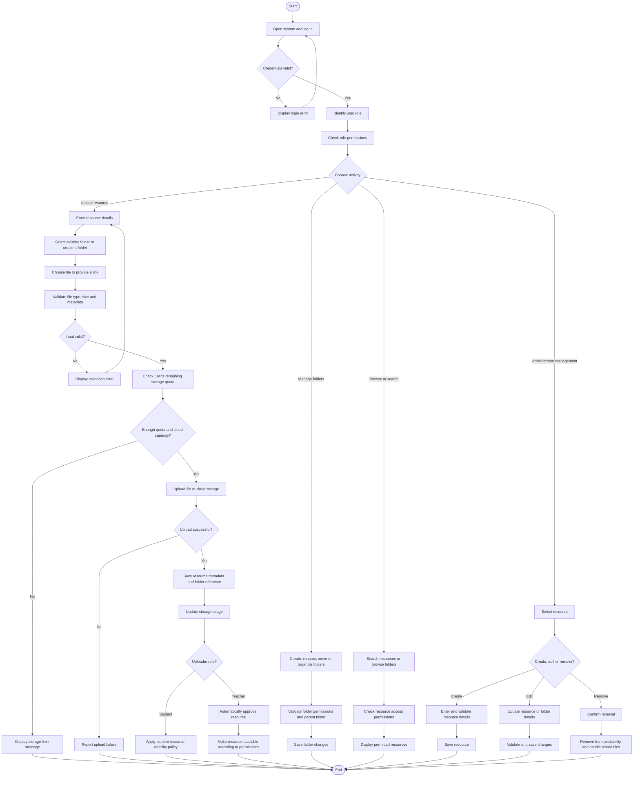
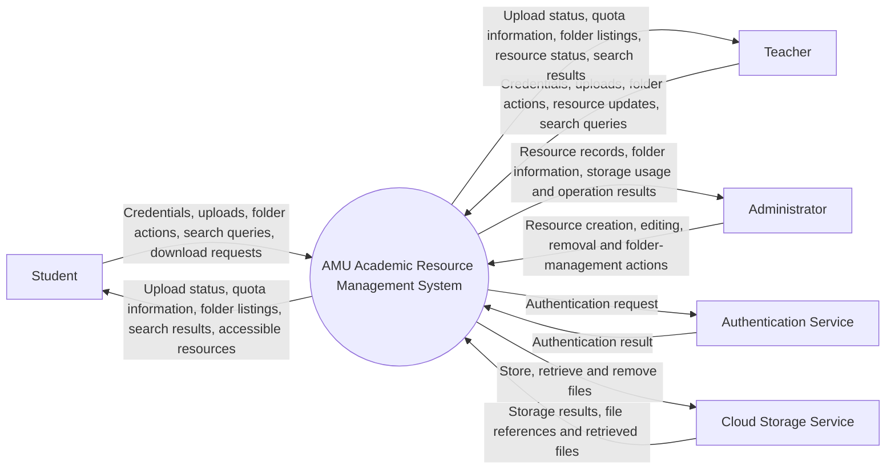
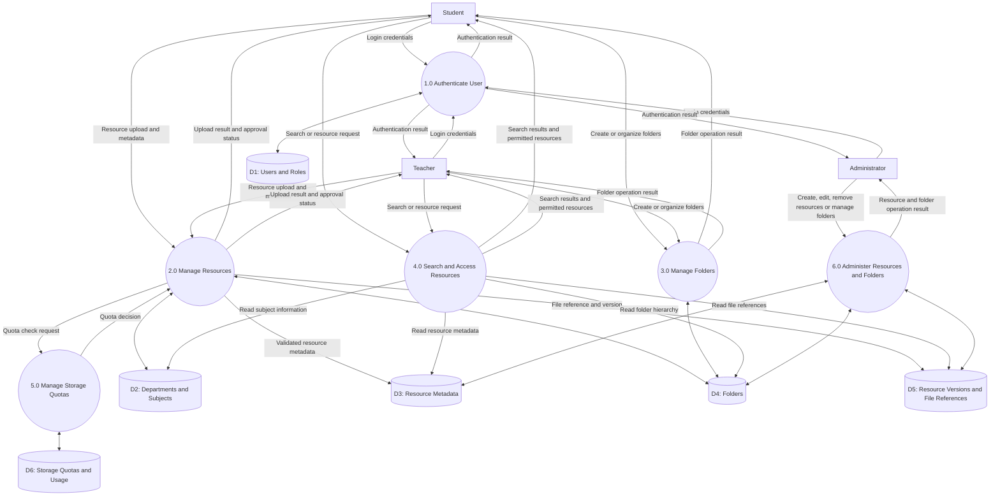
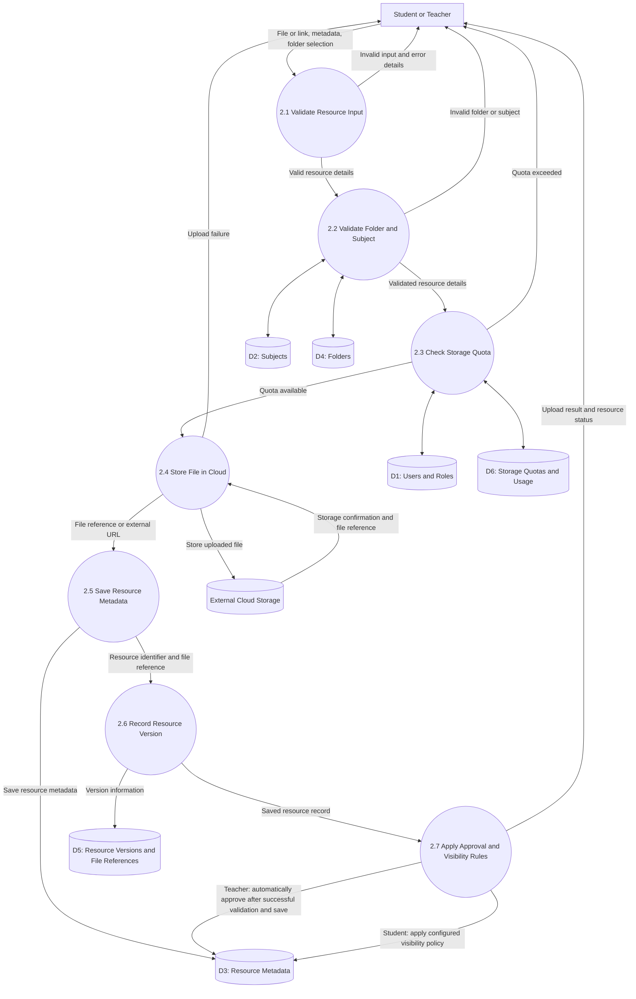
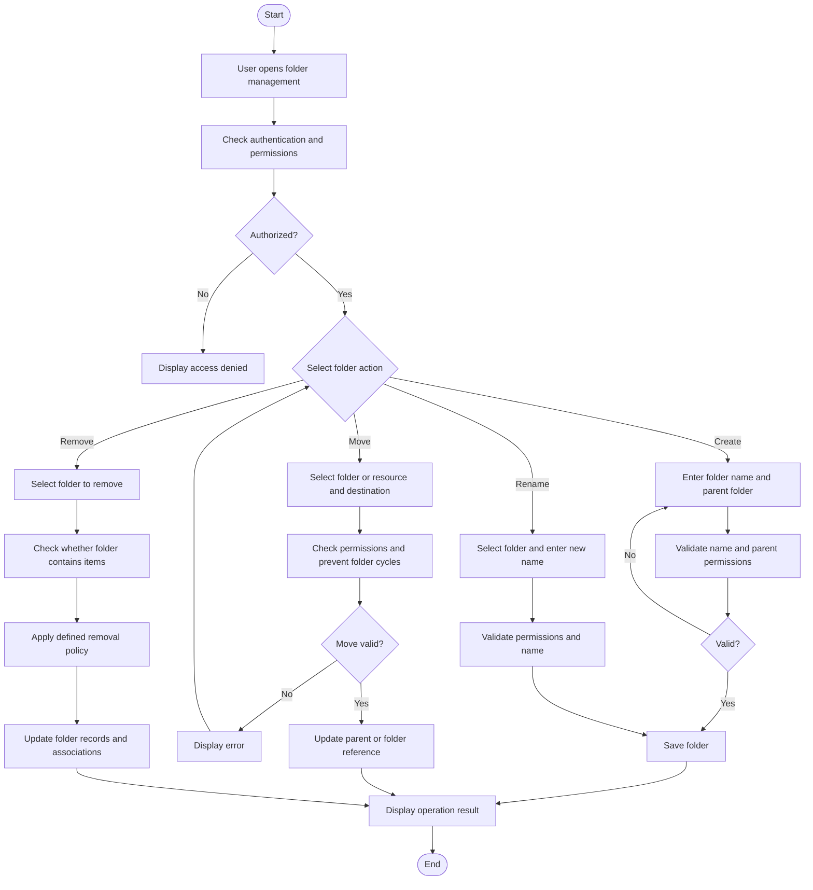

# AMU Cloud-Based Academic Resource Management System

## Phase 7: Process Modelling and Phase 8: Data Analysis

This revised version includes folder management and organization, student and teacher upload quotas, automatic approval of teacher uploads after validation, and administrator resource-management permissions.

### Confirmed system rules

| Feature                   | Agreed requirement                                                    |
| ------------------------- | --------------------------------------------------------------------- |
| Student storage quota     | 1 GB per student                                                      |
| Teacher storage quota     | 15 GB per teacher                                                     |
| Student uploads           | Allowed within the student's quota                                    |
| Teacher uploads           | Allowed within the teacher's quota                                    |
| Teacher resource approval | Automatically approved after validation and successful saving         |
| Administrator permissions | Create, edit, and remove resources                                    |
| Folder management         | Organize resources into folders and subfolders                        |
| Resource discovery        | Search and browse resources, including by folder and subject          |
| Cloud storage             | Check file size, file type, and remaining user quota before uploading |

The maximum individual file size and the overall cloud-provider capacity still need to be defined separately. A user's quota limits the storage they can consume; it does not guarantee that the overall cloud account has unlimited capacity.

# Phase 7: Process Modelling

## 7.1 Objective

Process modelling describes the activities performed by students, teachers, and administrators, the system's boundaries, and how information moves between system processes and data stores.

## 7.2 Activity Diagram — Uploading and Organizing Resources

This diagram covers login, folder selection or creation, upload validation, storage quota enforcement, and the different permissions of students, teachers, and administrators.

Notes for the report:

- Folder operations must check permissions so users cannot edit or delete another user's private folders.
- A folder may contain subfolders and resources. Moving a resource should update its folder reference without duplicating the stored file.
- Teacher uploads are automatically approved only after validation and successful saving.
- The visibility policy for student uploads needs a final decision. This diagram intentionally does not assume that student uploads receive automatic approval.
- Deleting a resource from the application and permanently deleting its cloud file are separate decisions. The system must handle both consistently.

## 7.3 Context Diagram

The context diagram shows the system as a single process and its interactions with external entities and supporting services.

### System boundary

Inside the system: user roles and permissions, resource metadata, upload validation, individual storage quotas, folder management, search, resource access, and resource administration.

Outside the system: the cloud storage provider and any external authentication provider, if one is used.

Moodle, SAMARTH-ERP, and the e-Library remain separate platforms. Direct integration with them is not assumed.

## 7.4 DFD Level 0 — Major Processes

The Level 0 Data Flow Diagram shows the major processes and the information exchanged with the system's data stores.

### Process descriptions

| Process                              | Responsibility                                                                                                                                         |
| ------------------------------------ | ------------------------------------------------------------------------------------------------------------------------------------------------------ |
| 1.0 Authenticate User                | Authenticates users and retrieves their role and permissions.                                                                                          |
| 2.0 Manage Resources                 | Validates uploads, checks quota availability, stores resource metadata and file references, and applies the appropriate approval or visibility policy. |
| 3.0 Manage Folders                   | Creates and organizes folders and subfolders, and moves resources between permitted folders.                                                           |
| 4.0 Search and Access Resources      | Searches resources, browses folders, and checks access permissions before providing resource access.                                                   |
| 5.0 Manage Storage Quotas            | Checks per-user quotas, records usage, and prevents uploads from exceeding available capacity.                                                         |
| 6.0 Administer Resources and Folders | Allows administrators to create, edit, and remove resources and perform authorized folder-management operations.                                       |

Storage quota rules: A student's allocation is 1 GB; a teacher's allocation is 15 GB. Uploads must pass both the user's quota check and the overall provider-capacity check.

The cloud storage provider is an external service. The actual file content resides there, while the database stores resource metadata, folder associations, version information, and file references.

## 7.5 DFD Level 1 — Manage Resources

This diagram expands process 2.0 to show validation, folder assignment, quota checking, file storage, metadata saving, and approval behaviour.

### Level 1 process explanation

1. 2.1 Validate Resource Input: Validate the title, resource type, file or URL, file format, and required metadata.
2. 2.2 Validate Folder and Subject: Confirm that the selected folder and subject exist and that the uploader has permission to use the folder.
3. 2.3 Check Storage Quota: Determine the user's role and verify that the upload fits within the remaining quota.
4. 2.4 Store File in Cloud: Store the file when the resource is file-based. A link-based resource does not need an uploaded file.
5. 2.5 Save Resource Metadata: Save the title, description, resource type, subject, folder, uploader, and current status.
6. 2.6 Record Resource Version: Record the initial version or a later version of the resource.
7. 2.7 Apply Approval and Visibility Rules: Automatically approve teacher uploads after successful validation and saving; apply the agreed policy for student uploads.

A real implementation should handle partial failures, including cloud uploads that succeed while metadata saving fails. It should also prevent concurrent uploads from exceeding the user's quota.

## 7.6 Additional Process — Folder Management

Folder management deserves its own detailed process because it is a core system feature.

Folder-management rules:

- Folders can contain subfolders and resources.
- Each folder has an owner or a defined access policy.
- Users may manage only folders for which they have permission.
- A folder cannot be moved inside itself or one of its descendants.
- Removing a non-empty folder requires a defined policy: reject the operation, move its contents, or remove its contents according to permissions.
- Moving a resource between folders should update its association without uploading the same file again.
- A folder name need not be globally unique; the chosen design may enforce uniqueness among siblings within the same parent folder.
