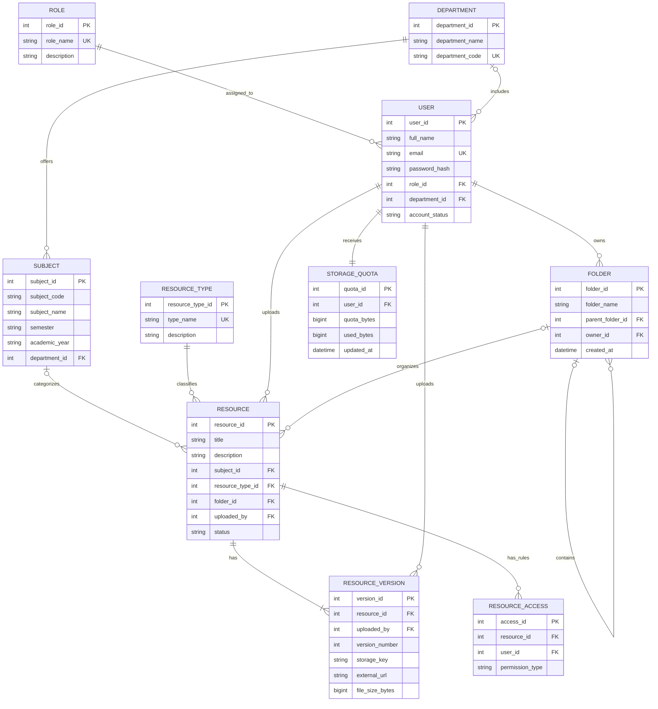

# AMU Cloud-Based Academic Resource Management System

# Phase 8: Data Analysis

## 8.1 Objective

Data analysis identifies the system's entities, attributes, relationships, cardinalities, primary keys, and constraints. This conceptual model includes resource uploads, folder organization, versions, access roles, and storage quota enforcement.

## 8.2 Major entities and attributes

| Entity                    | Important attributes                                                                                                                      | Purpose                                                                                |
| ------------------------- | ----------------------------------------------------------------------------------------------------------------------------------------- | -------------------------------------------------------------------------------------- |
| User                      | `user_id`, `full_name`, `email`, `password_hash`, `role_id`, `department_id`, `account_status`, `created_at`                              | Stores student, teacher, and administrator accounts.                                   |
| Role                      | `role_id`, `role_name`, `description`                                                                                                     | Defines the user's role and baseline permissions.                                      |
| Department                | `department_id`, `department_name`, `department_code`                                                                                     | Organizes academic users and subjects.                                                 |
| Subject                   | `subject_id`, `subject_code`, `subject_name`, `semester`, `academic_year`, `department_id`                                                | Represents academic subjects.                                                          |
| ResourceType              | `resource_type_id`, `type_name`, `description`                                                                                            | Classifies notes, assignments, lab manuals, question papers, and other resource types. |
| Folder                    | `folder_id`, `folder_name`, `parent_folder_id`, `owner_id`, `created_at`, `updated_at`                                                    | Organizes resources into folders and subfolders.                                       |
| Resource                  | `resource_id`, `title`, `description`, `subject_id`, `resource_type_id`, `folder_id`, `uploaded_by`, `status`, `created_at`, `updated_at` | Stores resource metadata and its current folder association.                           |
| ResourceVersion           | `version_id`, `resource_id`, `version_number`, `storage_key`, `external_url`, `file_size_bytes`, `uploaded_by`, `uploaded_at`             | Stores file or link version details and file size.                                     |
| StorageQuota              | `quota_id`, `user_id`, `quota_bytes`, `used_bytes`, `updated_at`                                                                          | Records each user's allocated and used storage.                                        |
| ResourceAccess (optional) | `access_id`, `resource_id`, `user_id` or `role_id`, `permission_type`                                                                     | Supports resource-specific permissions if the system requires them.                    |

### Why Folder is a separate entity

The Folder entity supports:

- Folder creation and renaming.
- Nested folders through `parent_folder_id`.
- Moving resources between folders.
- Organizing resources by topic, semester, academic year, or user preference.
- Folder ownership and permission checks.

A folder's `parent_folder_id` is a self-referencing foreign key to another Folder. A root folder has no parent.

### Why StorageQuota is a separate entity

The StorageQuota entity records the allocation and usage for each user.

| User role | Quota in bytes | Human-readable quota |
| --------- | -------------- | -------------------- |
| Student   | 1,073,741,824  | 1 GiB                |
| Teacher   | 16,106,127,360 | 15 GiB               |

These values use binary units (1 GiB = 1,024 MiB). If your team means decimal GB instead, use 1,000,000,000 bytes per GB and 15,000,000,000 bytes for 15 GB. Pick one convention and use it consistently in the report and implementation.

The quota is assigned based on role when the account is provisioned or its role changes. If an administrator has a separate quota, that policy must be specified independently.

## 8.3 Entity relationships and cardinalities

| Relationship               | Cardinality | Explanation                                                                                                     |
| -------------------------- | ----------- | --------------------------------------------------------------------------------------------------------------- |
| Role — User                | 1:N         | One role can be assigned to many users; each user has one primary role in this model.                           |
| Department — User          | 1:N         | A department can contain many users; a user's department may be optional.                                       |
| Department — Subject       | 1:N         | A department offers multiple subjects.                                                                          |
| Subject — Resource         | 1:N         | A subject can have many resources.                                                                              |
| ResourceType — Resource    | 1:N         | Each resource has one type; a type can classify many resources.                                                 |
| User — Resource            | 1:N         | A student or teacher can upload multiple resources; each resource has one original uploader.                    |
| User — Folder              | 1:N         | A user can own multiple folders; each folder has one owner in this model.                                       |
| Folder — Folder            | 1:N         | A folder can contain multiple subfolders; a subfolder has zero or one parent folder.                            |
| Folder — Resource          | 1:N         | A folder can contain multiple resources; a resource can be assigned to zero or one folder in the initial model. |
| Resource — ResourceVersion | 1:N         | A resource can have multiple versions; each version belongs to one resource.                                    |
| User — ResourceVersion     | 1:N         | A user can upload multiple resource versions.                                                                   |
| User — StorageQuota        | 1:1         | Each student or teacher has one storage quota record.                                                           |
| Resource — ResourceAccess  | 1:N         | A resource may have multiple access rules if resource-specific permissions are implemented.                     |

If you later support multiple roles per user, multiple subjects per resource, or shared folders with several owners, the conceptual model will need additional junction entities.

## 8.4 Primary keys and important constraints

| Entity          | Primary key        | Important constraints                                                                                                                                 |
| --------------- | ------------------ | ----------------------------------------------------------------------------------------------------------------------------------------------------- |
| User            | `user_id`          | Email must be unique; role must reference an existing Role; account status must be valid.                                                             |
| Role            | `role_id`          | `role_name` must be unique.                                                                                                                           |
| Department      | `department_id`    | Department code must be unique.                                                                                                                       |
| Subject         | `subject_id`       | Must reference a department; subject code and academic period should follow agreed uniqueness rules.                                                  |
| ResourceType    | `resource_type_id` | Type name must be unique.                                                                                                                             |
| Folder          | `folder_id`        | Must reference an owner; parent folder must exist if provided; folder hierarchy must not contain cycles.                                              |
| Resource        | `resource_id`      | Must reference a valid uploader and resource type; title must not be empty; folder and subject references must be valid when provided.                |
| ResourceVersion | `version_id`       | Must reference an existing resource and uploader; version number must be positive; `(resource_id, version_number)` must be unique.                    |
| StorageQuota    | `quota_id`         | `user_id` must be unique; quota and used-storage values must be non-negative; used storage must not exceed the assigned quota under normal operation. |
| ResourceAccess  | `access_id`        | Must reference an existing resource and a valid user or role; permission type must be valid.                                                          |

### Business rules

1. Students receive a 1 GB quota; teachers receive a 15 GB quota.
2. Every uploaded file must pass file-type, file-size, and metadata validation.
3. The system must verify available user quota and provider capacity before accepting a file.
4. Teacher resources are automatically approved after successful validation and saving.
5. Student uploads follow the visibility policy agreed upon by the project team.
6. Administrators can create, edit, and remove resources.
7. Folder operations must respect ownership and access permissions.
8. A resource's folder reference must be updated when it is moved.
9. File sizes must be recorded in bytes to support accurate quota calculations.
10. Quota usage must be updated reliably after successful uploads and deletions; concurrent uploads must not exceed the quota.
11. Resource versions must not accidentally count the same stored file twice. If each version is stored as a separate physical file, each version's size counts toward storage usage.
12. Removing a resource should follow a defined policy for its versions, file storage, and folder associations.

## 8.5 Conceptual ER Diagram

This ER diagram shows the major entities, their keys, and the relationships between them.

Diagram notes:

- `PK` denotes a primary key, `FK` a foreign key, and `UK` a unique attribute.
- The Folder-to-Folder relationship models nested folders.
- Resource-to-Folder is optional so that a resource may temporarily be unfiled, if the team permits it.
- `ResourceAccess` is optional if permissions are handled entirely through roles and folder ownership. If the system supports only role-based access, omit it from the initial version.
- `StorageQuota` is one-to-one with User. The quota amount is assigned according to the user's role.
- The diagram assumes each resource has at least one version. If resources can be created as drafts before a file or link is attached, that rule should be relaxed.

## 8.6 How folder management and storage quotas work together

| User action        | Folder behaviour                                                                           | Storage behaviour                                                                                                |
| ------------------ | ------------------------------------------------------------------------------------------ | ---------------------------------------------------------------------------------------------------------------- |
| Create folder      | Create a folder under an authorized parent, or create a root folder.                       | Does not consume file-storage quota by itself.                                                                   |
| Upload file        | Save the resource in the selected folder.                                                  | Validate the file, check quota and provider capacity, then update usage after successful saving.                 |
| Move resource      | Update its folder association.                                                             | No additional storage is consumed if the file is not duplicated.                                                 |
| Create subfolder   | Save a parent-child relationship.                                                          | No file-storage usage unless the provider separately charges for metadata.                                       |
| Upload new version | Keep the resource in its existing folder unless the user chooses another permitted folder. | Count the new stored version if it occupies additional storage.                                                  |
| Remove resource    | Remove or update the resource's folder association.                                        | Reduce usage only after the corresponding stored files are actually deleted or no longer count toward the quota. |
| Rename folder      | Update the folder name.                                                                    | No file-storage usage change.                                                                                    |

## 8.7 Consistency between Phase 7 and Phase 8

| Requirement                                    | Process model                    | Data entities                                 |
| ---------------------------------------------- | -------------------------------- | --------------------------------------------- |
| User authentication                            | Authenticate User                | User, Role                                    |
| Upload academic resources                      | Manage Resources                 | User, Resource, ResourceType, ResourceVersion |
| Organize resources in folders                  | Manage Folders                   | Folder, Resource                              |
| Browse and search resources                    | Search and Access Resources      | Resource, Folder, Subject, ResourceType       |
| Enforce individual quotas                      | Manage Storage Quotas            | StorageQuota, User, ResourceVersion           |
| Automatically approve teacher uploads          | Manage Resources                 | Resource                                      |
| Manage resources administratively              | Administer Resources and Folders | Resource, ResourceVersion, Folder             |
| Retain file versions                           | Manage Resources                 | ResourceVersion                               |
| Enforce optional resource-specific permissions | Search and Access Resources      | ResourceAccess                                |

## 8.8 Conclusion

Phase 7 defines the system's processes, data flows, folder-management activities, and upload-quota checks. Phase 8 identifies the data entities and relationships required to support those processes.

The proposed model now incorporates 1 GB per student, 15 GB per teacher, resource uploads by both roles, automatic approval of teacher uploads after validation, administrative resource management, and hierarchical folder organization.

Before finalizing the report, the team should confirm the student-upload visibility policy, maximum individual file size, folder-sharing rules, and whether storage quotas count every resource version separately. These decisions will help keep the diagrams, requirements, and eventual database design consistent.