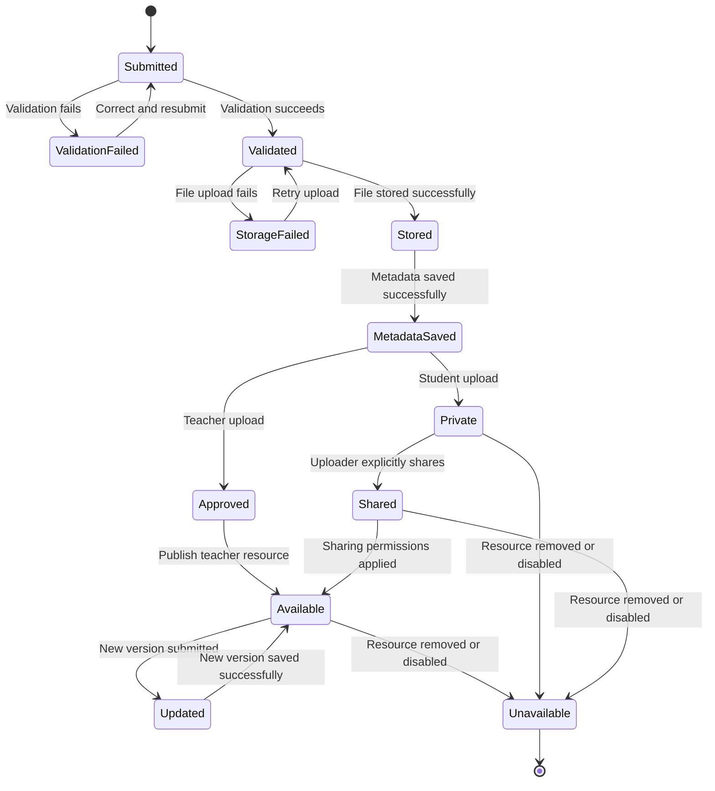
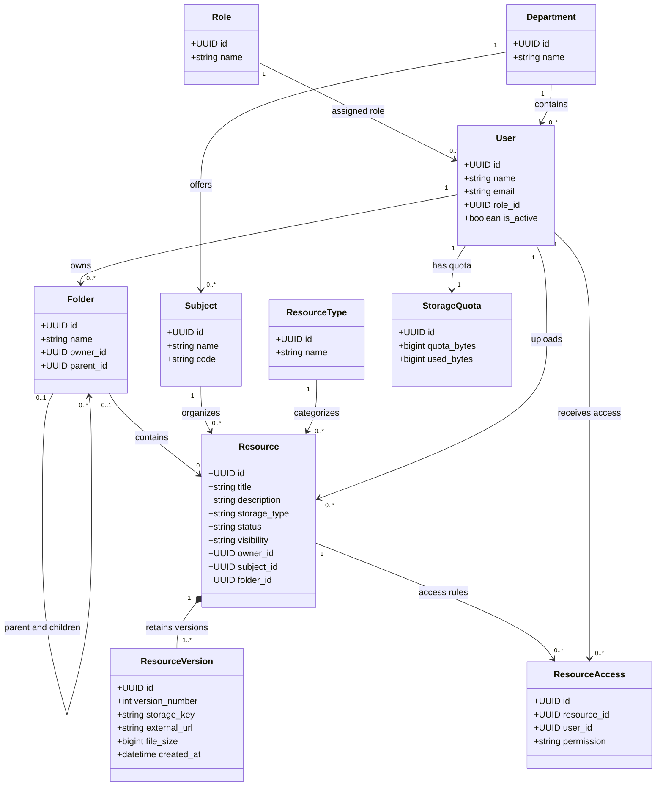

# Phase 9 — Finalized System Models and Consistency Review

Project: AMU Cloud-Based Academic Resource Management System

The five decisions are now incorporated into the Phase 9 models. The lifecycle, class diagram, and consistency rules below reflect the agreed requirements.

## 1. Resource lifecycle state diagram

The key change is that student uploads remain private to the uploader until explicitly shared, while teacher uploads are automatically approved after validation and successful storage.

### Lifecycle rules

1. Every uploaded file must pass validation before storage.
2. Teacher uploads become approved only after successful validation, file storage, and metadata saving.
3. Student uploads remain private by default. Sharing must be an explicit action by the uploader.
4. External links are supported alongside uploaded files. Links must undergo URL and permission validation; they do not require file-byte storage.
5. Updating a resource creates a new version while retaining previous versions according to the version-retention policy.
6. Failed uploads or metadata operations must not leave resources marked as successfully available.

Implementation clarification: `Available` means the resource is accessible to users authorized by its visibility and sharing rules, not publicly accessible to everyone.

## 2. Class diagram

The diagram now uses one role per user, includes both uploaded files and external links, and models storage quotas and retained versions explicitly.

### Class model constraints

- One role per user: `User.role_id` references one `Role`. Authorization must check that assigned role on every protected operation.
- Folder hierarchy: A folder can have one parent and multiple child folders. Prevent circular parent-child relationships.
- Folder deletion: A folder may be deleted only when it contains no resources and no subfolders.
- Resource versions: Every resource has at least one retained version. Each version records its own file reference or external URL.
- File versus URL: Each version must represent exactly one storage type: an uploaded file or an external link, never both.
- Quota accounting: Count the sizes of all retained uploaded-file versions. External links do not consume uploaded-file storage quota.
- Resource access: Sharing creates an explicit access rule or equivalent permission record. Private student resources must not be visible through general browsing or search to unauthorized users.

## 3. Final consistency review

| Area                 | Final rule                                                                 | Status                     |
| -------------------- | -------------------------------------------------------------------------- | -------------------------- |
| Roles                | Each user has exactly one role                                             | Finalized                  |
| Student uploads      | Private to uploader until explicitly shared                                | Finalized                  |
| Teacher uploads      | Auto-approved after validation, successful storage, and metadata saving    | Finalized                  |
| Student quota        | 1 GB per student                                                           | Finalized                  |
| Teacher quota        | 15 GB per teacher                                                          | Finalized                  |
| Version accounting   | All retained uploaded-file versions count toward quota                     | Finalized                  |
| External links       | Supported as resources; no uploaded-file quota usage                       | Finalized                  |
| Folder deletion      | Non-empty folders cannot be deleted                                        | Finalized                  |
| Folder relationships | Parent-child hierarchy; circular references prohibited                     | Finalized                  |
| Resource access      | Every view, download, search result, and share action respects permissions | Finalized                  |
| Admin permissions    | Administrators can create, edit, and remove resources                      | Finalized                  |
| Storage failures     | No successful resource state until storage and metadata operations succeed | Finalized as a design rule |

### 4. Quota enforcement example

Suppose a student uploads a 100 MB resource and later replaces it with a 120 MB version.

- Original retained version: 100 MB
- New retained version: 120 MB
- Total quota usage: 220 MB

If the original version is explicitly removed under the version-retention policy, usage can decrease accordingly. Merely making the new version current does not release the old version's quota.

The backend must enforce quotas transactionally so that simultaneous uploads cannot push an account over its limit. The 1 GB and 15 GB user quotas are separate from the overall cloud-storage capacity and any individual file-size limit.

## 5. Final implementation acceptance checklist

- Resource lifecycle includes validation, storage, metadata saving, approval, sharing, and version updates.
- Class diagram uses one role per user.
- Student resources are private by default.
- Teacher uploads are automatically approved after successful processing.
- Both uploaded files and external links are supported.
- All retained uploaded-file versions count toward quota.
- Non-empty folders cannot be deleted.
- Folder cycles and unauthorized access are prohibited.
- Search and download respect visibility and access rules.
- Failed storage or metadata operations are handled without incorrectly publishing a resource.

